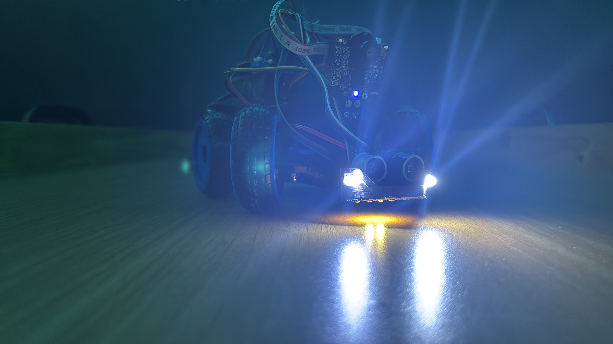
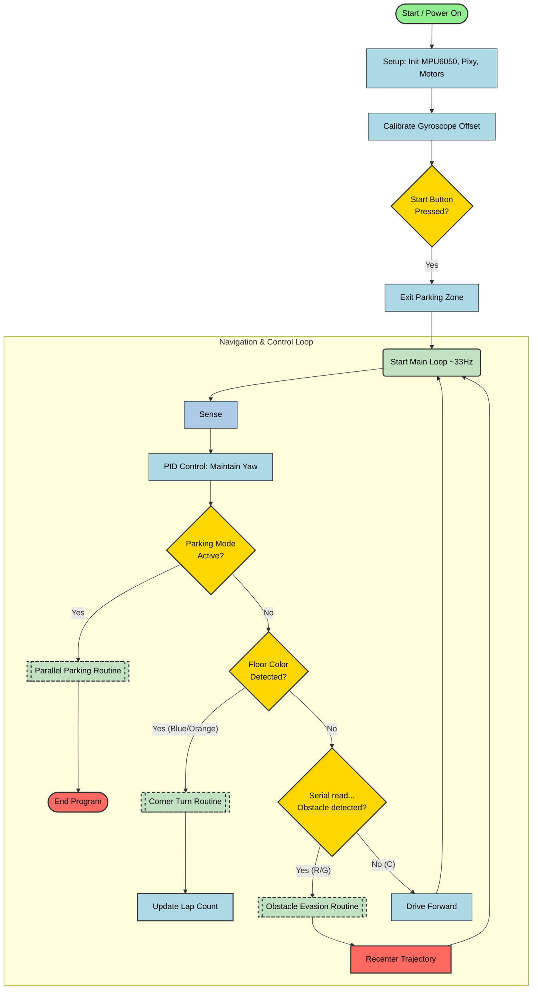
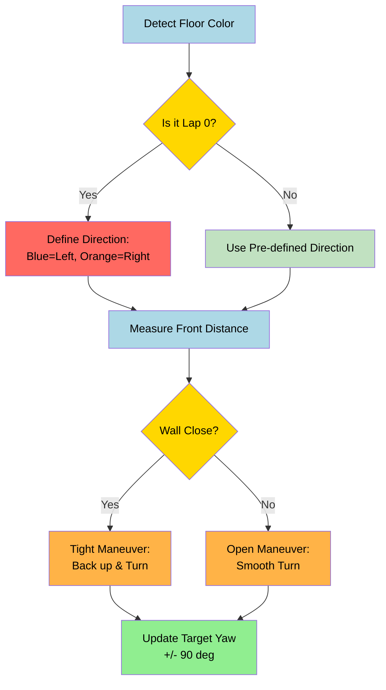
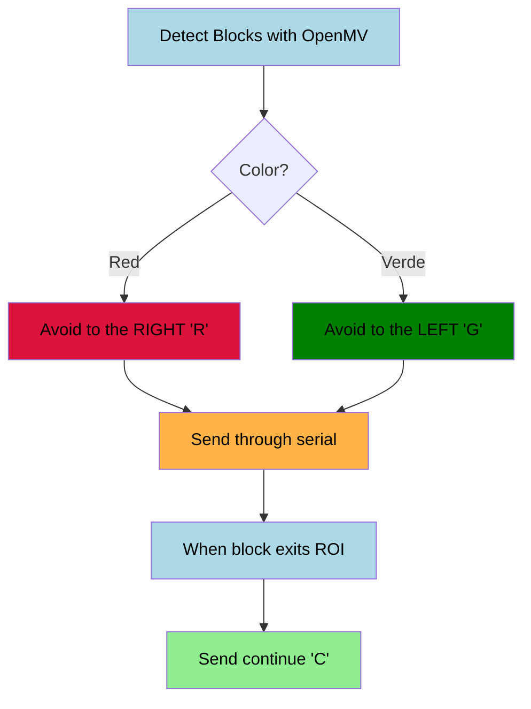

# 1. Project Overview

## 1.1 Introduction to VizDrive 2026

ViZio is an autonomous robot developed by a Panamanian 🔴⚪🔵 Team VizDrive for the **2025 and 2026 World Robot Olympiad (WRO)**.
Our project participates in the **Future Engineers** category. Our goal is to apply advanced robotics, data analysis, error management, and optimization principles to represent Panama again in the international field of robotics.

The primary objective of ViZio is to autonomously navigate a predefined closed-loop circuit, and to detect and evade obstacles. This is achieved using a combination of artificial vision for obstacle detection, and an array of sensors for decision-making. Every single part of the robot is designed, optimized, and constructed by the VizDrive Team.

In the Future Engineers category, we compete in two distinct challenge rounds: the **Open Challenge** and the **Obstacle Challenge**. While the robot shares most of its core functionalities across both rounds, there are key adjustments between the two. For clarity, we present the robot as a unified system in this documentation, and highlight the specific differences as they arise.

## 1.2 Main Components

| Component | Function |
| ---------------- | ------------------------------------------------------------------------------------------------------------------------ |
| **DC Motor** | Employed for rear-wheel drive (RWD) propulsion. |
| **Wheel Encoder** | Measures the rotational pulses per revolution (PPR) of the wheels, used for odometry and precise maneuvers. |
| **Servo Motor** | Utilized for steering control of the front wheels. |
| **OpenMV H7 Plus** | Responsible for obstacle recognition and color-based detection. |
| **Ultrasonic Sensors** | Measures real-time distance to walls, used for turns and collision avoidance. |
| **MPU Gyroscope with PID Control** | Provides continuous orientation data, which is processed by a Proportional-Integral-Derivative (PID) controller, to ensure stable and straight trajectory. |
| **Color Sensor** | Employed for detecting specific colored lines marked on the circuit, signaling turns. |

Each of these parts have their own separated document, delving into their calibration, common errors, logic and function in the robot.

## 1.3 Dimensions

| Specification | Information |
| ---------------- | ---------- |
| Height | 15 cm |
| Width | 14 cm |
| Length | 27 cm |
| Weight | 841 g |

---

## 1.4 Main Operational WorkFlow

The robot's operation can be divided into three phases:

### 1. **Initialization Phase (Setup):**

* **Power-Up** and **Hardware Initialization:** upon power-up, the robot ensures all sensors and actuators are operational. If a sensor is not initialized correctly, the program will not start.

* **Gyroscope Callibration:** the MPU gyroscope offset is calibrated to ensure orientation accuracy before entering the main control loop.

* **Waiting for Start:** when the robot is ready for operation an LED indicator illuminates to signal readiness, and the program starts upon a button press.

### 2. **Autonomous Navigation Phase:**

This is the primary operational phase, running in a continuous **33 Hz** main loop where the robot senses and adapts to its environment:

* **Orientation Correction (Continuous):**
  * The **MPU-6050** provides real-time orientation data.
  * This data is fed into a dedicated PID (Proportional-Integral-Derivative) controller, which compensates for any rotational drift, ensuring the robot maintains a stable and straight heading throughout its trajectory.
  * To correct the **MPU-6050's accumulated offset**, in the **Obstacle Challenge**, the robot uses the rear wall to **reset its yaw angle**. On the other hand, in the **Open Challenge**, it uses the robot's **parallel distance to the wall**.
* **Floor Color and Corner Navigation (Conditional):**
* The system checks if floor color is detected. If blue or orange is detected, the robot executes a corner turn routine.
* For corner turns, the system checks if it is Lap 0 to define the direction (Blue=Left, Orange=Right) or uses a pre-defined direction for subsequent laps. It then measures the front wall distance to execute either a tight maneuver (backing up and turning) or an open smooth turn, and updates the target yaw by ±90°.

* **Obstacle Detection and Evasion (Conditional):**
  * While maintaining trajectory, if no floor color is detected, the **OpenMV H7** constantly scans the path ahead for obstacles.
  * When a block is detected, the camera evaluates its color (Red for right evasion 'R', Green for left evasion 'G') and transmits the command through serial.
  * The robot executes the obstacle evasion routine while recentering its trajectory until the block exits the ROI, at which point a continue command ('C') is sent.
  * If no obstacle is detected, the robot continues driving forward while recentering its trajectory.

### 3. **Completion Phase:**

* The robot transitions to this phase after completing the required number of laps.
  * **Parking Maneuver:** the robot initiates a maneuver to arrive to the parking lot; afterwards, it executes a pre-calculated parking maneuver to conclude the challenge.

---

## 1.5 General Workflow Diagram

Made with Mermaid for GitHub. Visit [Workflow Diagram](./../assets/flowcharts/) folder if the image is distorted or not seen.

Visit:

[Main Workflow Diagram.png](./../assets/flowcharts/Workflow%20Diagram%20-%20Navigation.png)

[Color and Ultrasonic Workflow Diagram.png](./../assets/flowcharts/Workflow%20Diagram%20-%20Color%20and%20Ultrasonic.png)

[OpenMV Workflow Diagram.png](./../assets/flowcharts/Workflow%20Diagram%20-%20OpenMV.png) 

If the image is distorted or not seen.

[Back to Main README.md Index](../README.md)
