# 10. 3D Modeling and Mechanics

This section details the comprehensive approach to the mechanical design and fabrication of the VizDrive robot. Our methodology emphasizes precision, durability, and a lightweight structure.

## 10.1 3D Modeling Tool: Blender & Fusion 360

We selected **Blender** as our primary 3D modeling software, accompanied with **Fusion 360** for greater CAD precision.

### Design Process in Blender

Our mechanical design workflow involved an iterative process:

1. **Conceptualization:** Initial sketches and rudimentary models were developed to define the robot's overall form factor and the preliminary placement of its components.
2. **Component Integration:** Detailed designs were created for mounts and enclosures, ensuring a perfect fit for all selected electronic components, including the Mega 2560 Pro (Embed), motor drivers, sensors, and battery.
3. **Structural Optimization:** Emphasis was placed on minimizing the robot's overall weight while maximizing its rigidity and structural strength. This involved applying techniques such as optimizing internal infill patterns during 3D printing.
4. **Iterative Refinement:** Physical prototypes were printed, their fit and function rigorously tested, and necessary design adjustments were iteratively made in Blender based on the empirical results.
5. **STL Export:** Finalized designs were exported as `.stl` files, the industry-standard format for 3D printing.

## 10.2 Mechanical Characteristics and Design Principles

VizDrive's mechanical design prioritizes precise and stable locomotion, integrating specific features to optimize performance.

* **Rear-Wheel Drive (RWD) Configuration**: The robot utilizes a RWD setup where a single DC motor drives the rear wheels via a solid axle. Front-wheel steering is achieved through a servo-controlled mechanism.
  * **Propulsion Motor**: A **Hobby Gearmotor with a 48:1 gearbox** is employed for the rear drive, selected for its ample torque suitable for various terrains.
  * **Steering Actuator**: A **Servo Motor SG90** is used to precisely control the angular position of the front steering wheels.
 
| V1 | V2 - V3 | V4 - V5 |
| ---------------- | ---------------- | ---------------- |
| 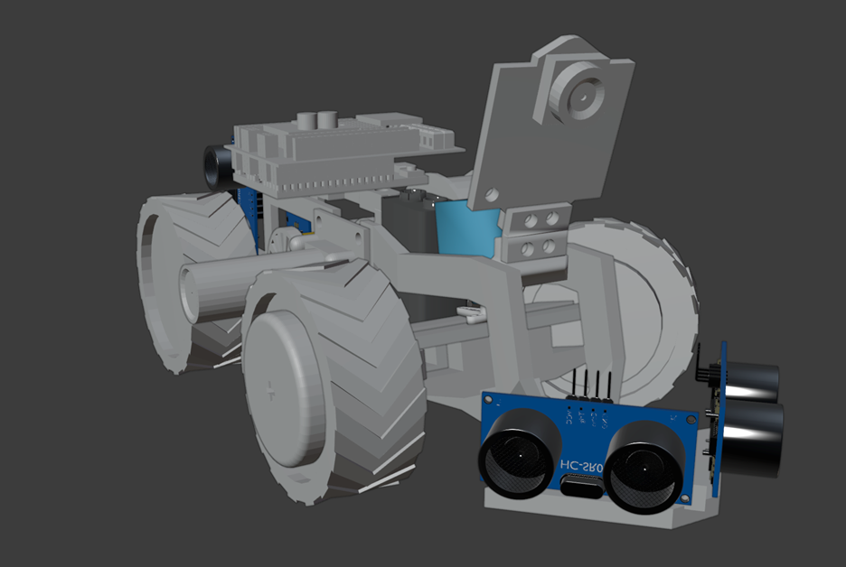 | 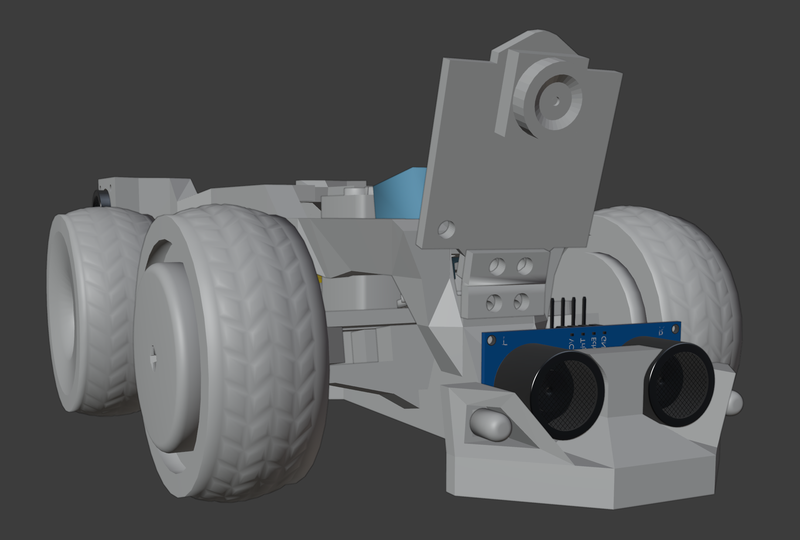 |  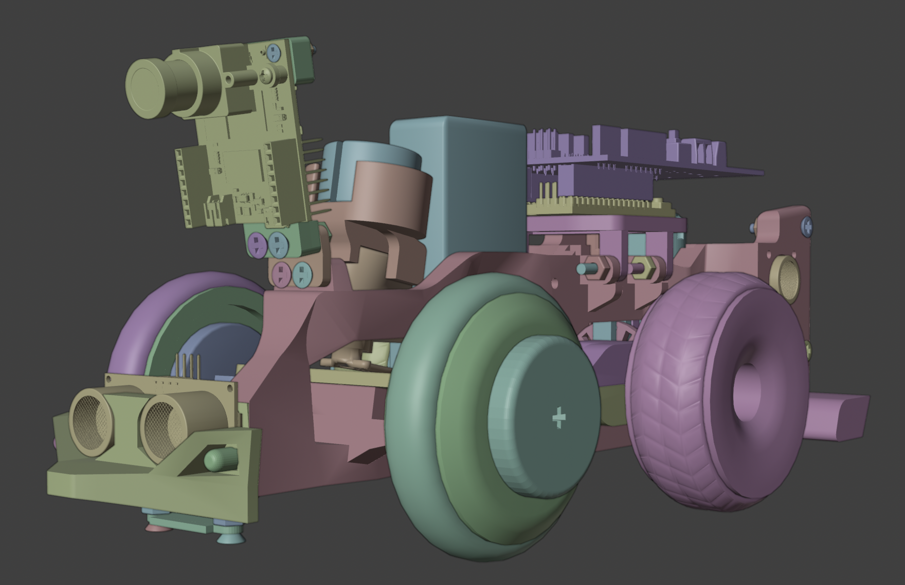 |

> [!NOTE]
> V2 - V3 and V4 - V5 chassis pairs are very similar, so they are displayed as one, the 3D model bank breaks down all models individually.

* **Light Frame Chassis**: The chassis is engineered as a lightweight beam structure. This compact design enhances driving precision and overall durability.

  * **V1 Main Silhouette**:

  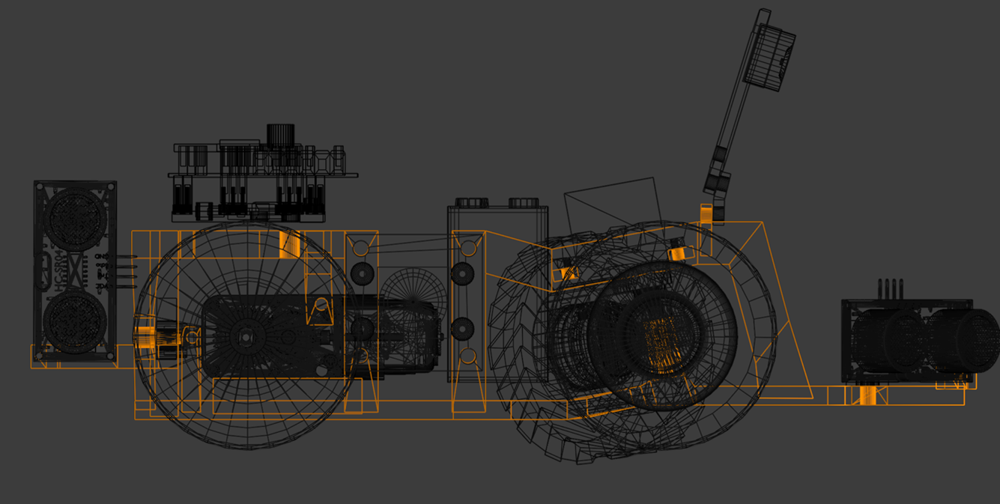

  * **V2 - V3 Silhouette**:

  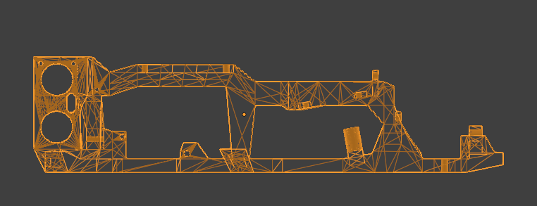

  * **V4 - V5 Silhouette**:

  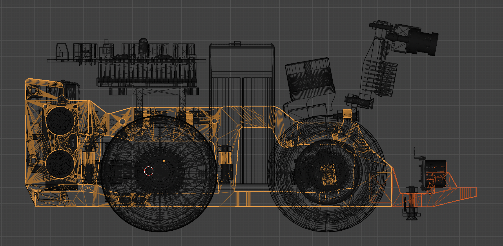

* **Tolerance Management**: Strategic variations in manufacturing tolerances were applied during part design:
  * **Snug Fit**: Components secured by screws are designed for a tight fit to ensure rigidity.
  * **Higher Tolerance**: Wheel and steering mechanisms incorporate greater tolerance. This allows for slight movement, reducing friction, and inadvertently contributes to a degree of passive suspension, which helps in accommodating minor ground irregularities and improving stability.

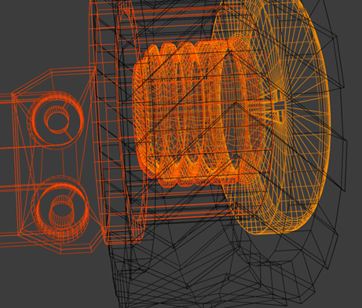

* **Caster Angle**: To mitigate any inherent imprecision arising from steering tolerances, a **caster angle of 10°** has been implemented. This geometric arrangement naturally biases the steering wheels to return to a centered, straight-ahead position, improving straight-line tracking stability.

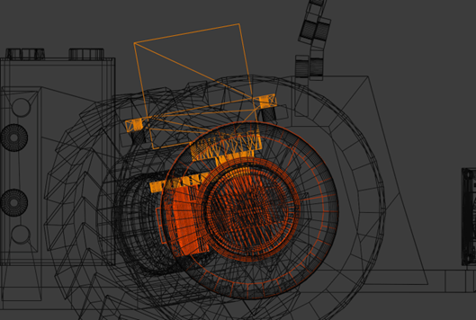

* **Steering Angle Capability**: The steering system is designed to achieve a **55-degree turn in each direction**. This range enables sharp maneuvers, including specialized actions like parallel parking.

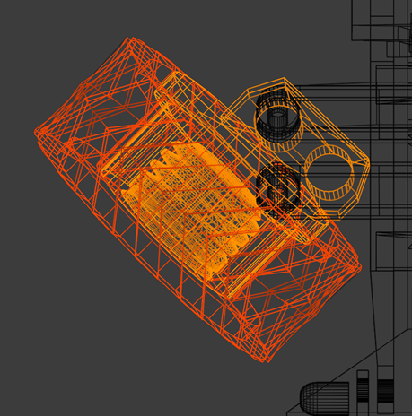

* **Screw Orientation**: Screws used in critical drivetrain assemblies are oriented to self-tighten as the robot moves forward. This design detail prevents screws from loosening and wheels from detaching due to friction, a particularly important consideration for 3D-printed hub designs that offer bidirectional screw orientation options.

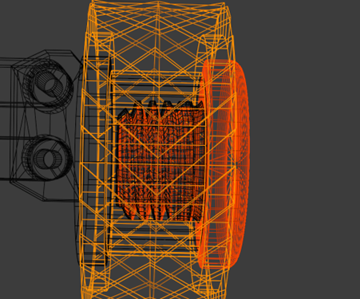

* **Bumper**: Orientation is reset using the bumper, aligning the robot to the outer wall which is crucial for long-term stable gyroscope functionality, mitigating not only drift, but also possbile noise caused by the robot's movement.

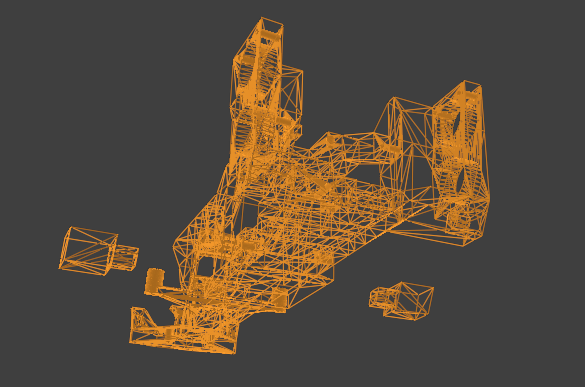

* **Servo Motor Support**: A secure servo mount was implemented to acquire steering stability and reduce possible errors. The caster angle implemented is working in conjunction with this system to achieve precise maneuvers.

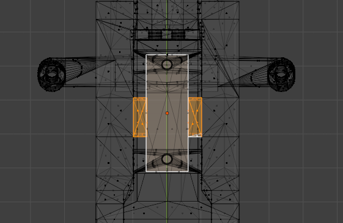

* **Ultrasonic Sensor Mount**: Snug-fit screwless mounts allow fast repairs and simpler building during competition. Tolerance management principles were applied to fine tune friction between the chassis and the sonars.

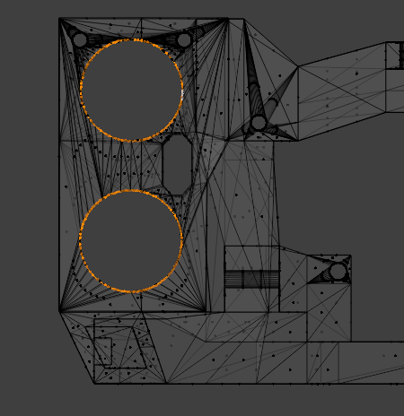

* **LED Headlights**: Additional illumination improves camera readings during low light scenarios. The PixyCam's built-in LEDs enhance lighting and suports the robot's headlights.

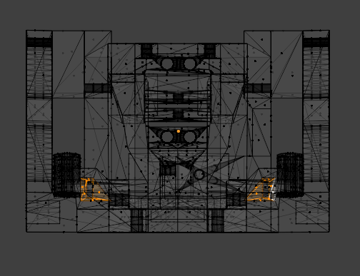

* **Flat Base**: The redesigned chassis has an array of benefits during the construction phase, not only facilitating it's assembly, but also improving printing time, quality, and durability.

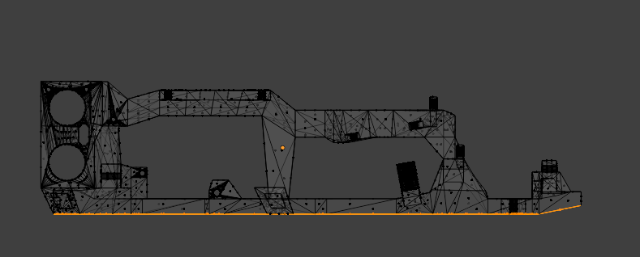

* **Double Camera Mount**: During the development of ViZio, multiple camera angles were tested to identify the best view. However, camera movement was restricted to a single fixed slot; hence, to further amplify flexibility, dual camera mounts were implemented into our new model.

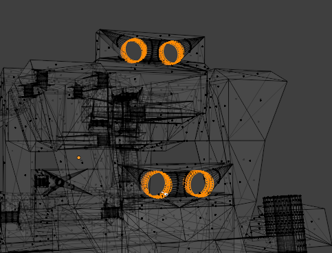

* **Differential Case**: A precise differential and axle holder was designed to properly accommodate complex parts precisely.

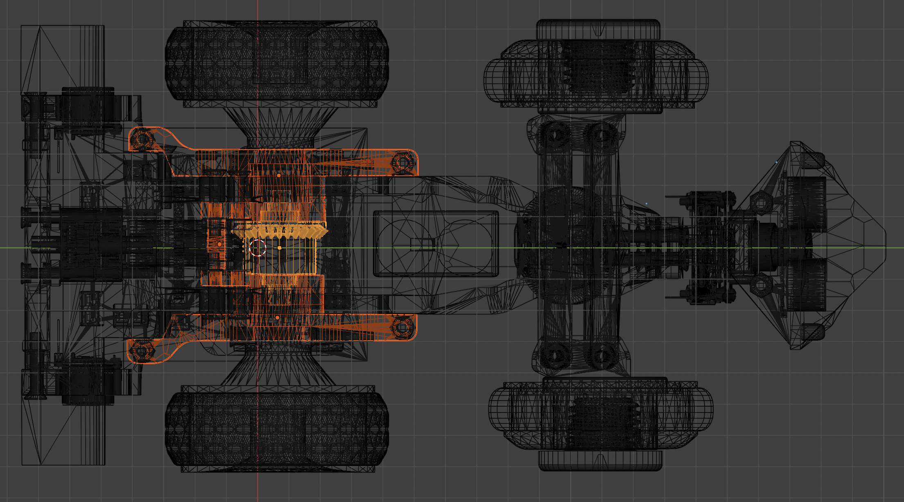

* **Openable Hood**: a door type compartment was created to allow easy battery access and swapping, also permitting more flexible instalation and construction.

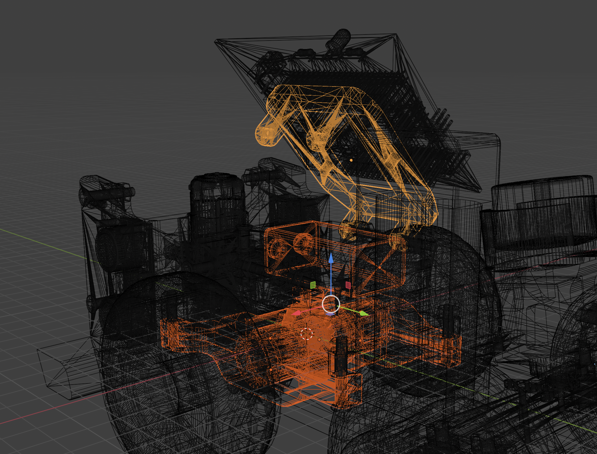

* **Mass Support**: A countermass was placed in the front of the vehicle to improve the center of mass, giving front wheels more grip on the track; thus, making turns sharper.

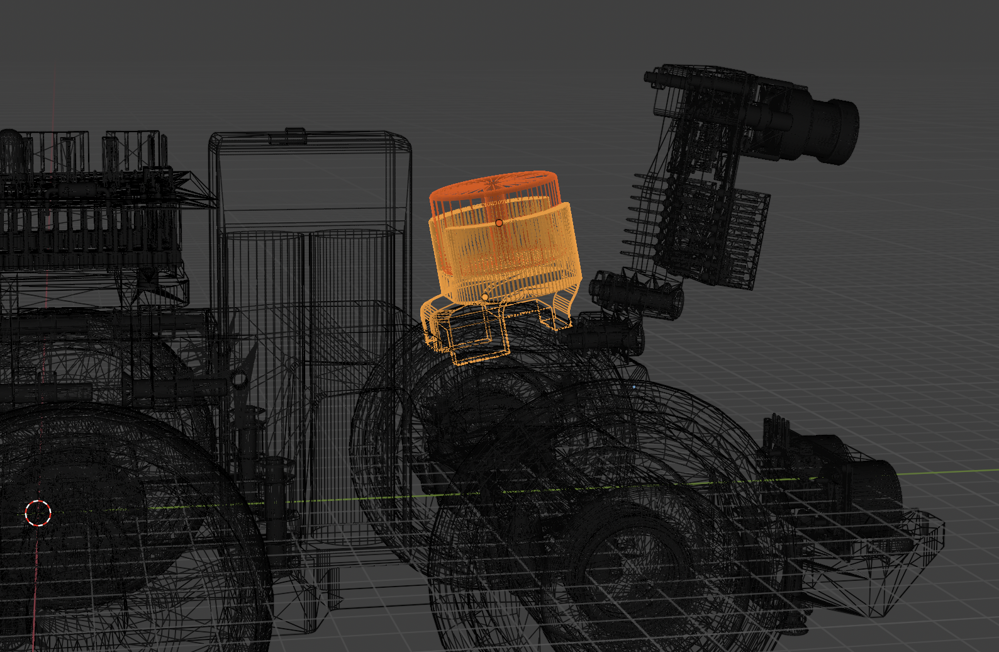

* **Separate Modules**: 3 separate supporting modules were printed: the front nose cone, which is holds the front color and ultrasonic sensors; a rear motor fixer, that tightly fastens the motor against the chassis, providing stable power throughout the track; and an encoder support, printed separately to build the differential system without disturbance and allow easy encoder installation.

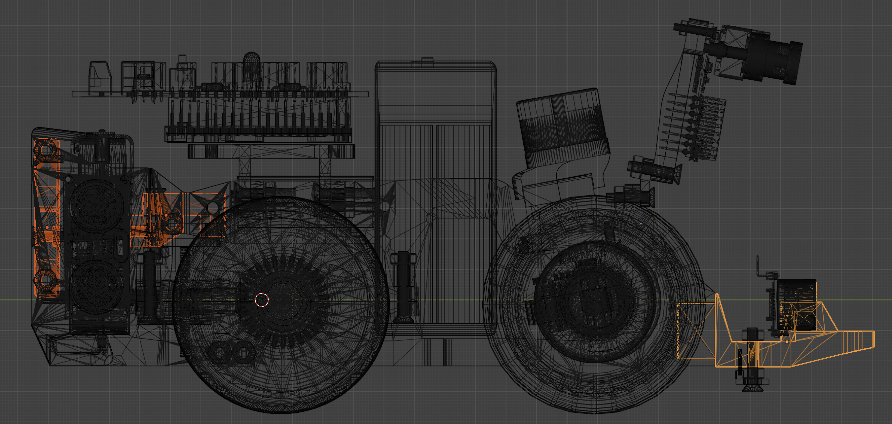

* **Smooth Edges**: This was an addition made to our V5 chassis, adding the deserved feel of a premium finish to our 2 time finalist robot.

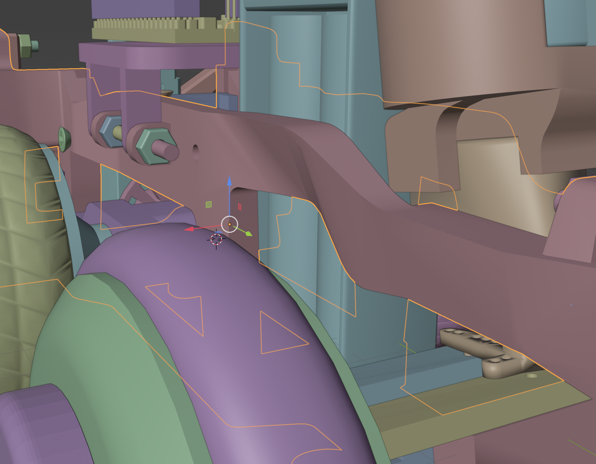

## 10.3 3D Printing and Parameters

All custom mechanical parts for VizDrive were mainly designed in Blender and fabricated using **PLA (Polylactic Acid)** filament via a **Creality Ender 3 3D printer**. PLA was selected for its ease of printing and sufficient strength for the application. While the following parameters are our standard settings, minor adjustments may be made for optimization.

> [!NOTE]
> All models presented will be arranged in reverse chronological order. ViZio Phase 5 parts have a **part ID** for easier identification.

### Chassis

**Description:** The primary structural frame, designed to be lightweight yet rigid, providing essential mounting points for motors, sensors, and the main controller.

#### **ViZio Phase 5**

  * **STL Files**
    * **Main Chassis** [ID: CHASSIS-01](./../models/ViZio5Models/ChassisMain.stl)
    * **Chassis Front** [ID: CHASSIS-02](./../models/ViZio5Models/ChassisFront.stl)
    * **Motor Support** [ID: MOTOR-01](./../models/ViZio5Models/MotorSupport.stl)
    * **Mass Support** [ID: MASS-01](./../models/ViZio5Models/MassSupport.stl)
    * **Ligature 1** [ID: LIGATURE-01](./../models/ViZio5Models/Ligature1.stl)
    * **Ligature 2** [ID: LIGATURE-02](./../models/ViZio5Models/Ligature2.stl)
    * **Axle** [ID: AXLE-01](./../models/chassis/axle.stl)
    * **Axle Support** [ID: AXLE-02](./../models/chassis/support.stl)
    * **Encoder Support** [ID: ENCODER-01](./../models/ViZio5Models/EncoderSupport.stl)
    * **Controller Support** [ID: CONTROLLER-01](./../models/ViZio5Models/ControllerSupport.stl)
    * **Bumper Left** [ID: CHASSIS-03](./../models/ViZio5Models/BumperLeft.stl)
    * **Bumper Right** [ID: CHASSIS-04](./../models/ViZio5Models/BumperRight.stl)
    * **Camera Mount** [ID: CAMERA-01](./../models/ViZio5Models/CameraSupport.stl)
    * **10° Support** [ID: CAMERA-02](./../models/ViZio5Models/10DegAdapter.stl)
  * **Interactive Models** 
    * **Interactive 3D Model** [Chassis Embed](https://vd-wro.github.io/VD26/embeds/chassis_26.2)

#### **ViZio IV**
  * **STL Files**
    * **3D Model (STL)** [Chassis](./../models/chassis/ViZio26V4Chassis.stl)
    * **3D Model (STL)** [Miscellaneous Parts](./../models/chassis/Miscellaneous_Parts.stl)
    * **3D Model (STL)** [Ligature 1](./../models/chassis/Lig1.stl)
    * **3D Model (STL)** [Ligature 2](./../models/chassis/Lig2.stl)
    * **3D Model (STL)** [Axle and Support](./../models/chassis/AxleAndSupport.stl)
    * **3D Model (STL)** [Mass Support](./../models/chassis/ViZioMassSupport.stl)
  * **Interactive Model** 
    * **Interactive 3D Model** [Chassis Embed](https://vd-wro.github.io/VD26/embeds/chassis_26)
#### **ViZio V3**
  * **3D Model (STL):** [Chassis](./../models/chassis/ViZioInternationalMotorFix.stl)
  * **Interactive 3D Model** [International Chassis Embed](https://vd-wro.github.io/VD26/embeds/chassis_final)
#### **ViZio 2.0**
  * **3D Model (STL):** [Chassis](./../models/chassis/chassis2.0.stl)
  * **Interactive 3D Model** [Updated Chassis Embed](https://vd-wro.github.io/VD26/embeds/interactive_chassis2)
#### **ViZio**
  * **3D Model (STL):** [Chassis](./../models/chassis/chassis.stl)
  * **Interactive 3D Model:** [Chassis Embed](https://vd-wro.github.io/VD26/embeds/interactive_chassis)

#### **Printing Parameters:**
  * Infill Type: Adaptive Cubic
  * Infill Density: 35%
  * Layer Height: 0.20 mm
  * Nozzle Temperature: 200°C
  * Bed Temperature: 60°C
  * Print Speed: 150mm/s
  * Material: ~120 g with support

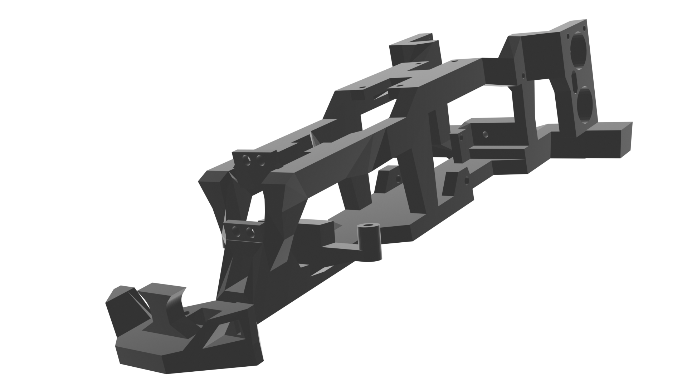

### Front Wheel Rims

**Description:** Custom-designed rims precisely shaped to fit into the wheel hubs.

#### **ViZio IV - ViZio Phase 5**

* **3D Model (STL):** [WHEEL-02](./../models/ViZio5Models/FrontWheel.stl)
* **Interactive 3D Model:** [Wheels Embed](https://vd-wro.github.io/VD26/embeds/front_wheel)

#### **ViZio - ViZio 2.0 - ViZio V3**
* **3D Model (STL):** [Wheels](./../models/wheels/wheel_rims.stl)
* **Interactive 3D Model:** [Wheels Embed](https://vd-wro.github.io/VD26/embeds/interactive_rims)

#### **Printing Parameters:**
* Infill Type: Adaptive Cubic
  * Infill Density: 35%
  * Layer Height: 0.20 mm
  * Nozzle Temperature: 200°C
  * Bed Temperature: 60°C
  * Print Speed: 150mm/s
  * Material: ~35 g with support

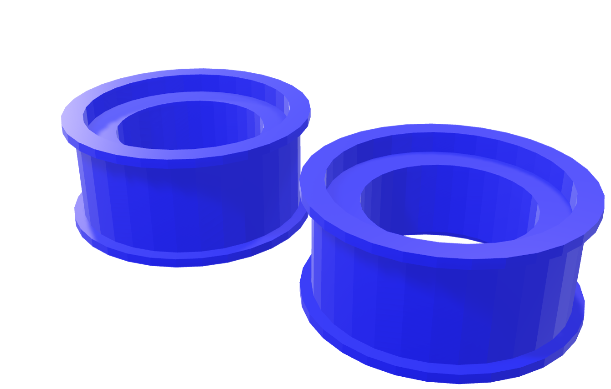

### Front Wheel Hubs with Screws

**Description:** Hubs designed to connect directly to the steering rod, incorporating integrated screws to securely hold the wheels in place.

#### **ViZio Phase 5**

* **Screws (STL):** [WHEEL-04](./../models/ViZio5Models/Screws.stl)
* **Hubs (STL):** [WHEEL-03](./../models/ViZio5Models/Rims.stl)
* **Interactive 3D Model:** [Wheel Hub Embed](https://vd-wro.github.io/VD26/embeds/interactive_hub)

#### **ViZio - ViZio 2.0 - ViZio V3 - ViZio IV**

* **3D Model (STL):** [Wheel Hub](./../models/wheels/wheel_hub.stl)
* **Interactive 3D Model:** [Wheel Hub Embed](https://vd-wro.github.io/VD26/embeds/interactive_hub)

#### **Printing Parameters:**
  * Infill Type: Adaptive Cubic
  * Infill Density: 35%
  * Layer Height: 0.20 mm
  * Nozzle Temperature: 200°C
  * Bed Temperature: 60°C
  * Print Speed: 150mm/s
  * Material: ~36 g with support

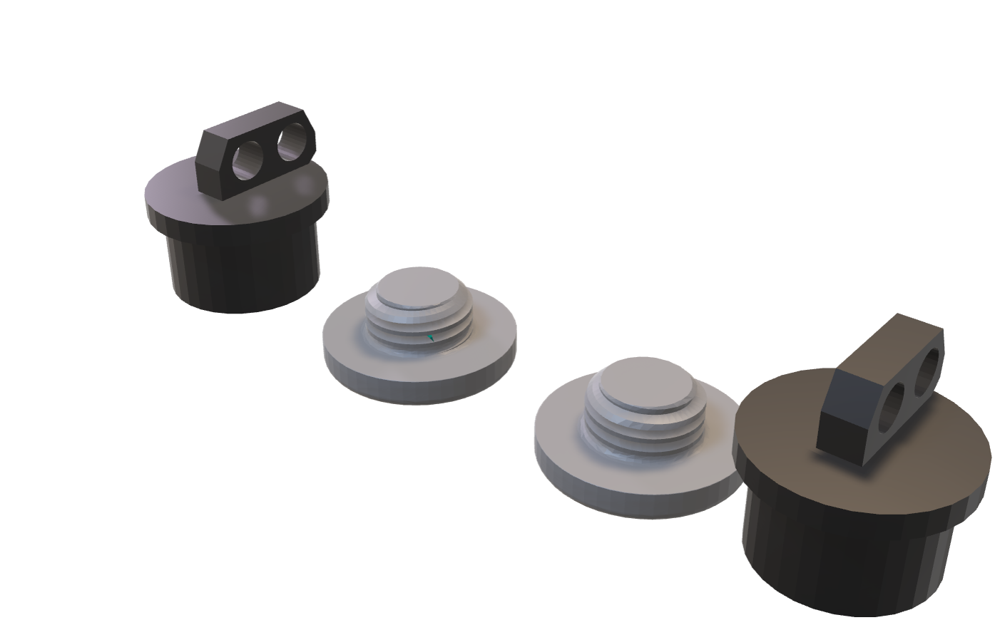

### Rear Wheels

**Description:** A precisely designed wheel directly coupled to the mechanical differential assembly to receive synchronized torque and rotational force.

#### **ViZio Phase 5**

* **3D Model (STL):** [WHEEL-01](./../models/ViZio5Models/RearWheel.stl)
* **Interactive 3D Model:** [Rear Wheel Embed](https://vd-wro.github.io/VD26/embeds/rear_wheel)

#### **ViZio IV**

* **3D Model (STL):** [Rear Wheel](./../models/wheels/rearwheels.stl)
* **Interactive 3D Model:** [Rear Wheel Embed](https://vd-wro.github.io/VD26/embeds/rear_wheel)

#### **ViZio - ViZio 2.0 - ViZio V3**

* **3D Model (STL):** [Wheel Encoder](./../models/wheels/encoder_wheel.stl)
* **Interactive 3D Model:** [Encoder Wheel Embed](https://vd-wro.github.io/VD26/embeds/interactive_rear_wheels)

#### **Printing Parameters:**
  * Infill Type: Adaptive Cubic
  * Infill Density: 35%
  * Layer Height: 0.20 mm
  * Nozzle Temperature: 200°C
  * Bed Temperature: 60°C
  * Print Speed: 150mm/s
  * Material: ~78 g with support

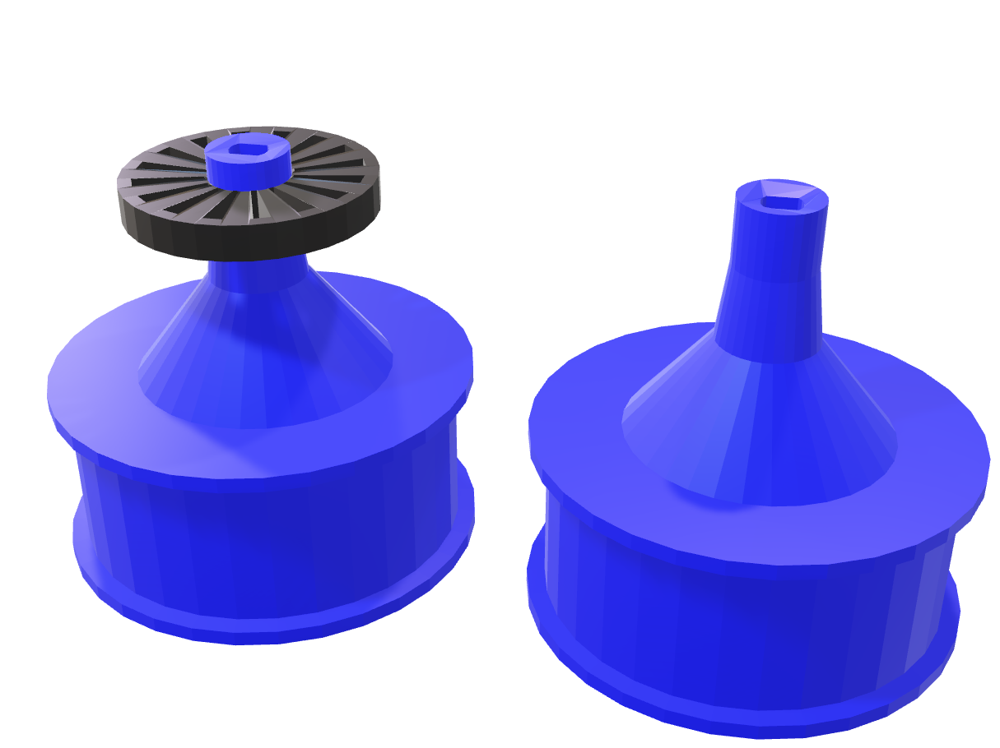

### Steering Rods and Camera Support

**Description:** Components for the steering rods that connect to the wheels, along with a camera mount designed with a slight 15° pitch angle for optimal PixyCam positioning; OpenMV camera supports are part of the [chassis](#chassis)

#### **ViZio Phase 5 - ViZio IV**

* **3D Model (STL):** [STEER-01-02](./../models/ViZio5Models/SteeringRods.stl)
* **Interactive 3D Model:** [Steering Rods Embed](https://vd-wro.github.io/VD26/embeds/rodsp5)

#### **ViZio - ViZio 2.0 - ViZio V3**

* **3D Model (STL):** [Steering Rods and Camera Support](./../models/steering/steering_rods.stl)
* **Interactive 3D Model:** [Steering Rods Embed](https://vd-wro.github.io/VD26/embeds/interactive_steering_rods)

#### **Printing Parameters:**
  * Infill Type: Adaptive Cubic
  * Infill Density: 35%
  * Layer Height: 0.20 mm
  * Nozzle Temperature: 200°C
  * Bed Temperature: 60°C
  * Print Speed: 150mm/s
  * Material: ~6 g with support

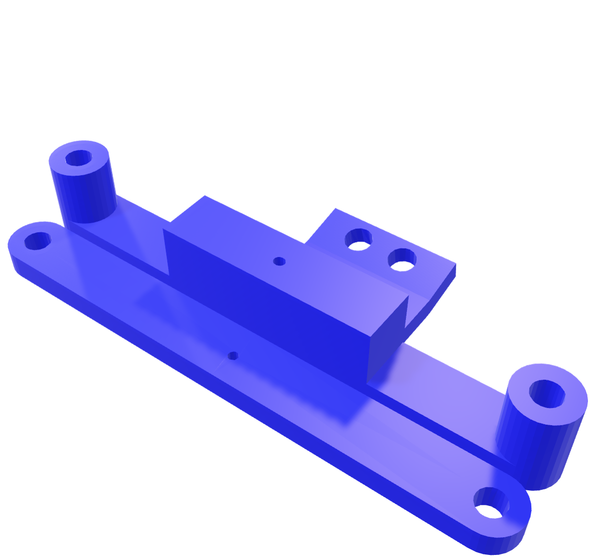

### Custom Printable Tyres

**Description:** ViZio uses pre-made tyres that come from robot kits/toy cars. If custom, 3D printed tyres are preferred, a model for our tyres is available to print in TPU.

#### **ViZio Phase 5 - ViZio IV**

* **3D Model (STL):** [WHEEL-05-06](./../models/wheels/PrintableTyre.stl)

#### **Printing Parameters:**
- **Material:** TPU 95A (~6 g, supports disabled / minimal)
- **Infill Type:** Gyroid
- **Infill Density:** 20%
- **Wall Loops:** 2
- **Layer Height:** 0.20 mm
- **Nozzle Temperature:** 225°C
- **Bed Temperature:** 45°C
- **Print Speed:** 35 mm/s (Max Volumetric Speed: ~3.5 mm³/s)

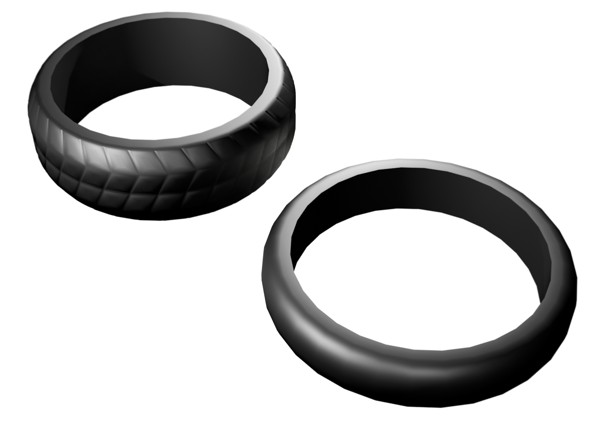

## 10.4 3D Printing Process

The fabrication process utilizing the Creality Ender 3 3D printer involved the following steps:

1. **Slicing:** STL models were converted into G-code (machine instructions) using Creality's slicer software. This step incorporates all specified printing parameters.
2. **Printing:** PLA filament was loaded, and the G-code was executed to build the parts layer by layer.
3. **Post-Processing:** Minimal post-processing was required for most components, primarily involving support material removal and light sanding to ensure aesthetic quality and a precise fit.

---

[Back to Main README.md Index](../README.md)
