# 12. Building Instructions

This document is intended to be used as a complete guide to build our robot. We have complemented this section with a building video, infographics, and comprehensive text for better replication.

Video: 

The following is the text description of ViZio's construction process. There are four main steps: Printing, Circuits, Assembling, and Software.

## Step 1 - Printing

| Part ID                      | Item Description      | Qty          | Model         | 
| :-------------------------------- | :--------------------------- |  :------------------------ | :---------------------- | 
| `CAMERA-01`    | Camera Mount                  | 1  | [Camera Mount](./../models/ViZio5Models/CameraSupport.stl)     |
| `CAMERA-02`    | Angled Camera Support         | 1  | [Angled Support](./../models/ViZio5Models/10DegAdapter.stl)    |
| `CHASSIS-01`   | Main Lower Chassis Deck          | 1  | [Chassis](./../models/ViZio5Models/ChassisMain.stl) |
| `CHASSIS-02`   | Frontal Sensor Mount Extension   | 1  | [Front Chassis](./../models/ViZio5Models/ChassisFront.stl) |
| `CHASSIS-03`   | Left Rear Bumper Extension     | 1  | [Chassis Bumper Left](./../models/ViZio5Models/BumperLeft.stl) |
| `CHASSIS-04`   | Right Rear Bumper Extension    | 1  | [Chassis Bumper Right](./../models/ViZio5Models/BumperLeft.stl) |
| `AXLE-01`  | Axle                                   | 1  | [Axle](./../models/chassis/axle.stl)|
| `AXLE-02`  | Axle Support                       | 1  |[Axle Support](./../models/chassis/support.stl)|
| `ENCODER-01`   | Encoder Support          | 1  | [Encoder Support](./../models/ViZio5Models/EncoderSupport.stl) |
| `LIGATURE-01`  | Right Suspension Control Linkage | 1  | [Ligature 1](./../models/ViZio5Models/Ligature1.stl) |
| `LIGATURE-02`  | Left Suspension Control Linkage  | 1  | [Ligature 2](./../models/ViZio5Models/Ligature2.stl) |
| `MASS-01`      | Mass Support                     | 1  | [Mass Support](./../models/ViZio5Models/MassSupport.stl)   |
| `CONTROLLER-01` |  Mega 2560 Pro Embed Platform   | 1  | [Mega Mount](./../models/ViZio5Models/ControllerSupport.stl) |
| `MOTOR-01`     | DC Motor Support                | 1  |  [Motor Support](./../models/ViZio5Models/MotorSupport.stl)  |
| `STEER-01`     | Upper Steering Link              | 2  | [Steering Rods](./../models/ViZio5Models/SteeringRods.stl) |
| `STEER-02`     | Lower Steering Link              | 1  | [Steering Rods](./../models/ViZio5Models/SteeringRods.stl) |
| `WHEEL-01`     | Rear Wheel                       | 1  |[Rear Wheels](./../models/ViZio5Models/RearWheel.stl) |
| `WHEEL-02`     | Front Wheel Rim                  | 1  | [Wheel Rims](./../models/ViZio5Models/Rims.stl) |
| `WHEEL-03`     | Front Wheel Hub                  | 1  | [Wheel Hubs](./../models/ViZio5Models/FrontWheels.stl)    |
| `WHEEL-04`     | Front Wheel Screw                | 1  | [Wheel Screws](./../models/ViZio5Models/Screws.stl)   |

**Overview of recommended settings:** 
* Infill Type: **Adaptive Cubic**
* Infill Density: **35% (best durability)**
* Layer Height: **0.28mm**

**More Information:** [More Details](10_3d_modeling.md)

## Step 2 - Circuits

| Part ID                      | Item Description      | Qty          |  
| :-------------------------------- | :--------------------------- |  :------------------------ |
| `BUCK_C-01`       | Mini DC-DC Step-Down Converter Module                    | 1  | 
| `BUTTON-01`       | Mini Pushbutton Switch                   | 1  | 
| `GYROSCOPE-01`       | MPU-6050 Accelerometer and Gyroscope Sensor                  | 1  | 
| `HEADER-01`       | Breakaway Male/Female Pin Headers                   | As required  | 
| `HEADER-02`       | Breakaway Male/Male Pin Headers                     | As required  | 
| `LED-01`       | Blue LED Light                     | 1  | 
| `MEGA-02`       | Mega 2560 Pro Embed                  |  1  | 
| `MOTOR-02`       | Mini MX1508 Motor Driver                    | 1  | 
| `PCB-01`       | Custom Printed Circuit Board                     | 1  | 
| `RESISTOR-01`       | Metal Film 330Ω Resistor                     | 1  | 
| `RESISTOR-02`     | Metal Film 10kΩ Resistor                      | 1  | 
| `SWITCH-02`       | Self-Locking Pushbutton Switch                   | 1  | 

We provide two options for this process: manually soldering the PCB, or fabricating it with a PCB supplier. Find the [circuit diagram or PCB files](#112-components-and-wiring).

## Step 3 - Assembly
| Part ID                      | Item Description      | Qty          |  
| :-------------------------------- | :--------------------------- |  :------------------------ | 
| `BATT-01`    | 9V Lithium-Ion Battery         | 1  | 
| `BATT-02`    | 3.7V Lithium-Ion Battery         | 2  | 
| `CAMERA-03`    | OpenMV H7 Plus Camera           | 1  | 
| `COLOR_S-01`  | TCS3472 Color Sensor                           | 1  | 
| `DIFFERENTIAL-03`  | Differential Case                            | 1  |  
| `DIFFERENTIAL-04`  | Pinion Gear                          | 1  |  
| `ENCODER-02`  |  Infrared Optocoupler Encoder                         | 1  |
| `JUMPER-01`    | Male-Female Jumper Wires           | 19  | 
| `LED-02`       | White LED Lights                     | 2  |  
| `MASS-02`  | 50g Mass                      | 1  | 
| `MOTOR-03`  | DC Motor with Hobby Gearmotor 48:1 Gearbox                          | 1  |  
| `SERVO-01`  | MG90S 9g Servo Motor                          | 1  |  
| `ULTRASONIC_S-01`  | Front HC-SR04 Ultrasonic Sensor   | 1  |
| `ULTRASONIC_S-02`  | Left Rear HC-SR04 Ultrasonic Sensor | 1  | 
| `ULTRASONIC_S-03`  | Right Rear HC-SR04 Ultrasonic Sensor | 1  |   
| `WHEEL-05`     | [Rear Tyre](10_3d_modeling.md#custom-tyres)             | 2  | 
| `WHEEL-06`     | [Front Tyre](10_3d_modeling.md#custom-tyres)                   | 2  |

### 2.1 Assemble Wheels

  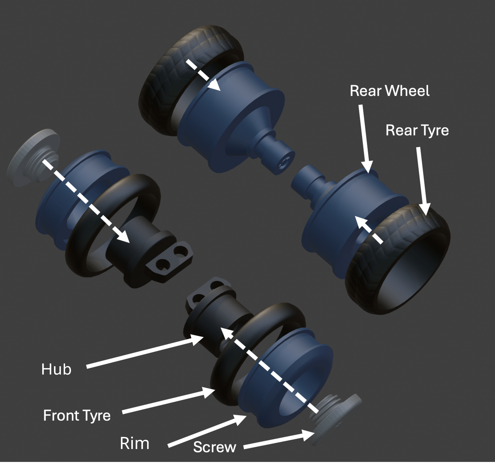

**Please note:** Front Screws and Rims are not symmetrical, notice there are left and right 3D models

### 2.2 Assemble Chassis

  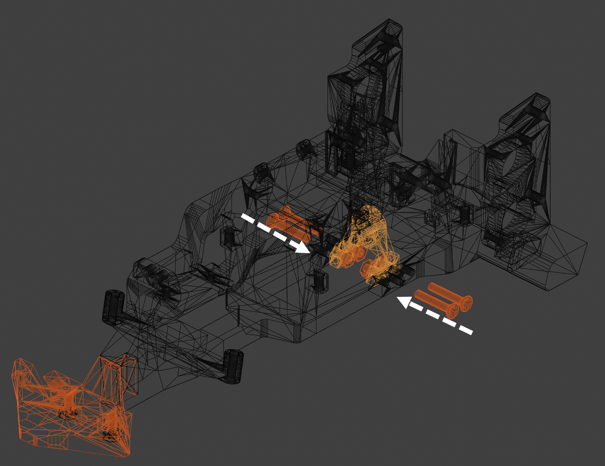

**Components in previous picture:** Nose Cone, M3 Screws, Axle Holder.

### 2.3 Assemble Rear Drive System

  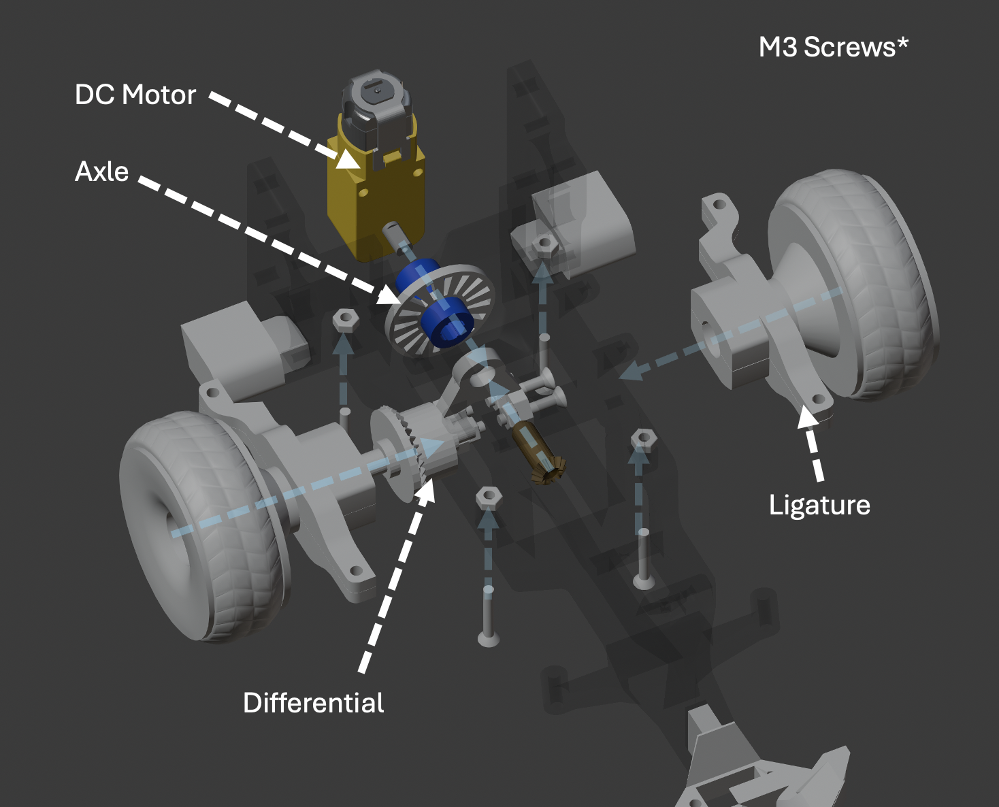

  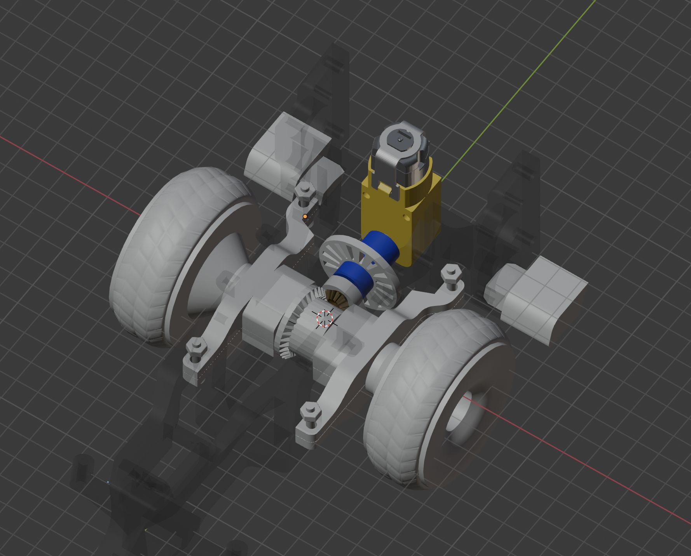

### 2.4 Assemble Encoder

  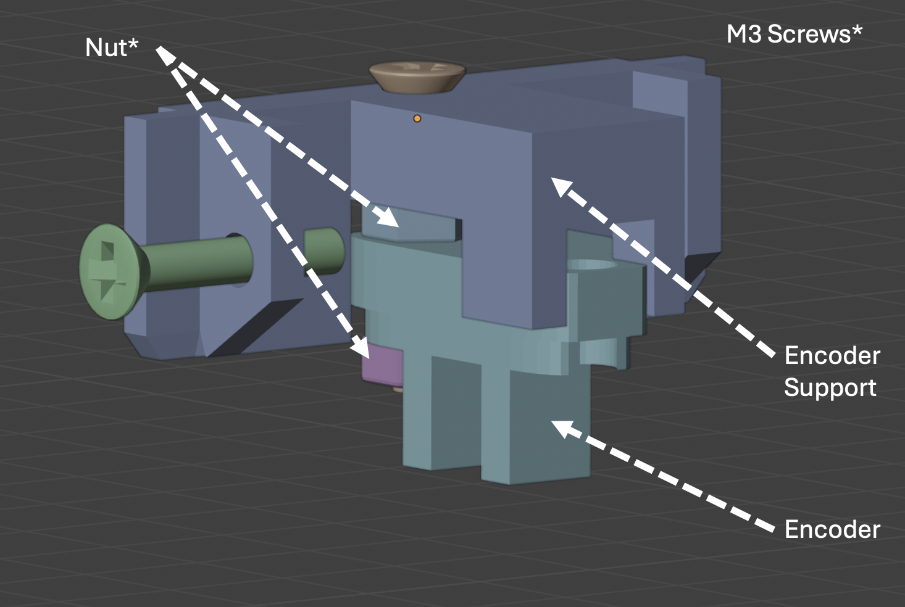

### 2.5 Secure Motor and Install Encoder

  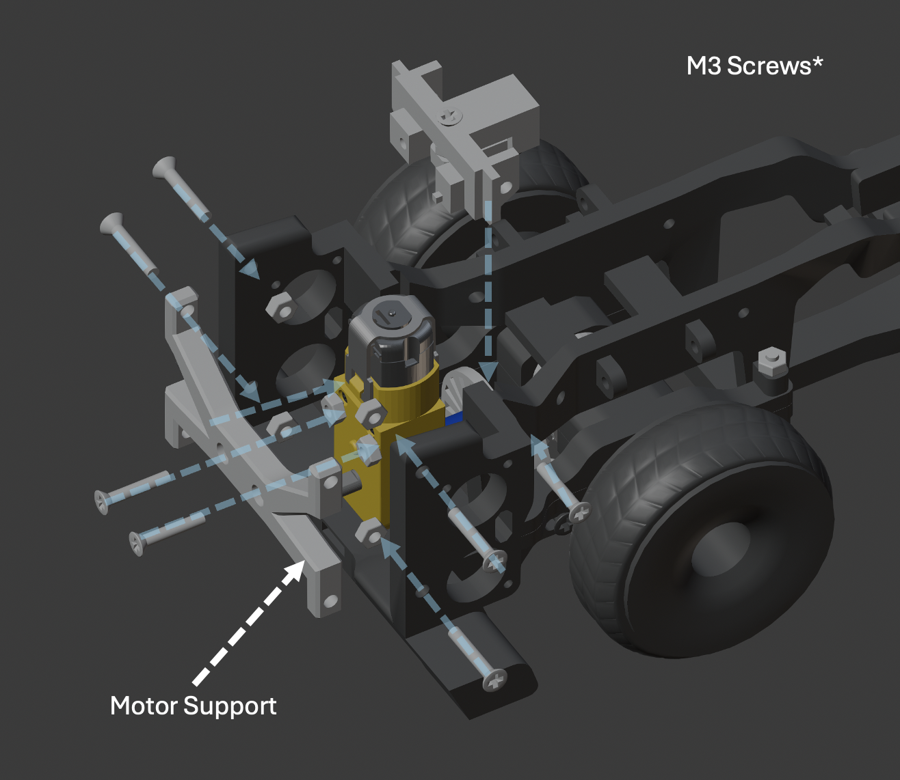

  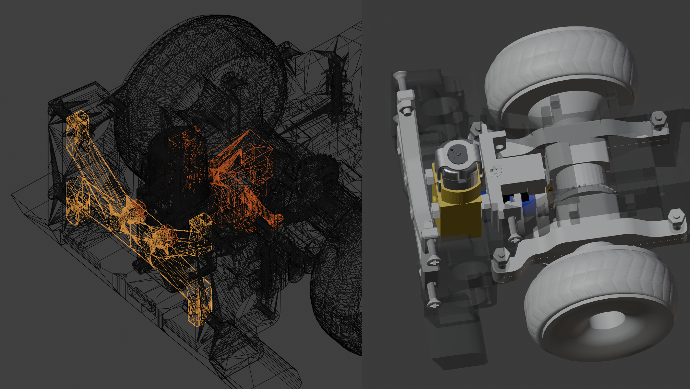

### 2.6 Build Front Axle

  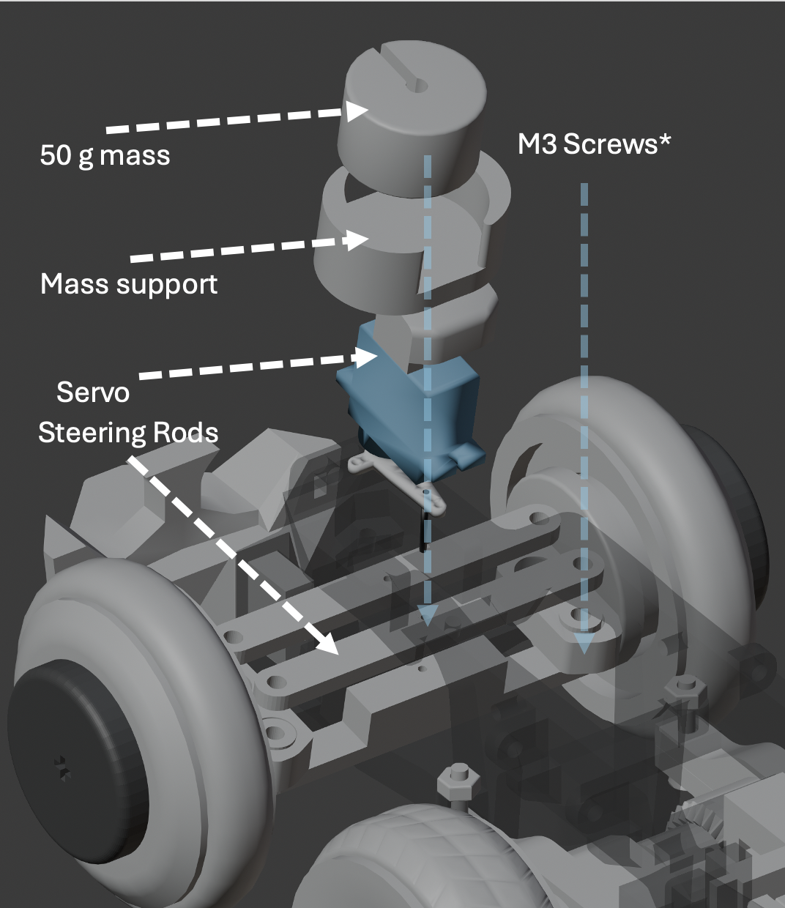

### 2.7 Place Rear Electronics

**Parts:** 2x Rear Ultrasonics, Custom PCB, Mega2560, Mega2560 Plaftorm.

  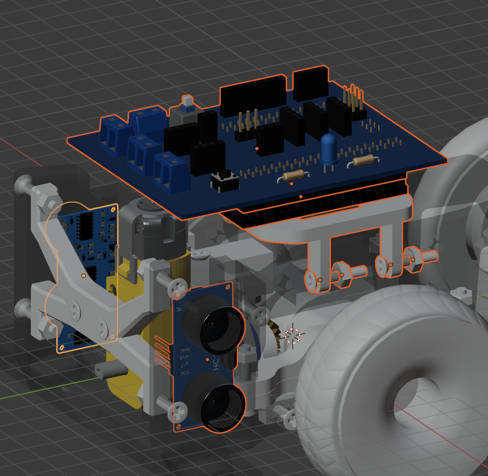

### 2.8 Place Front Electronics

**Parts:** Front Ultrasonic, TCS3472 Color Sensor, OpenMV.

  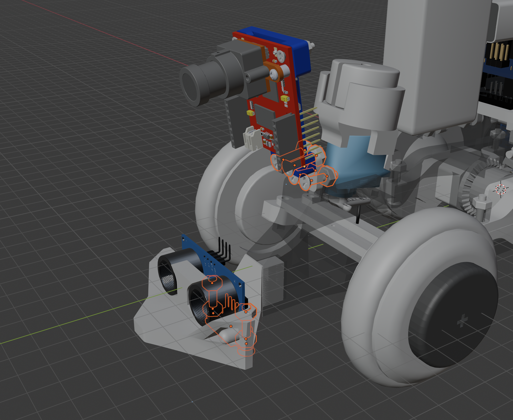

### 2.9 Place Batteries

**Parts:** 9V batteries, 2x 3.7V batteries.

  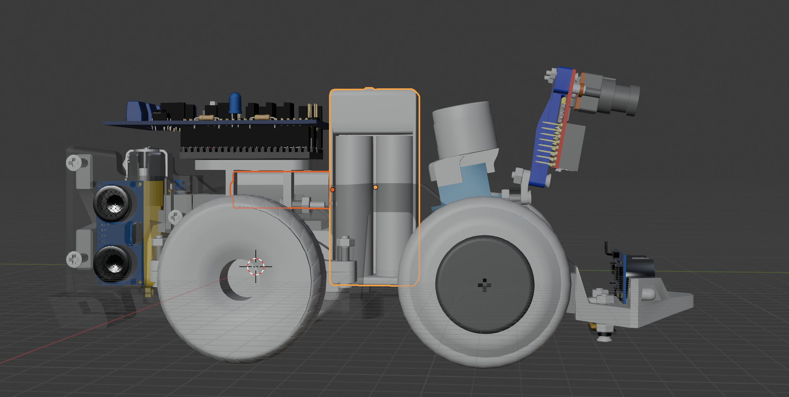

## Step 4 - Software

**Required Apps:**

* **[Arduino IDE](https://www.arduino.cc/en/software)**  
  Required for writing, compiling, and uploading C++ firmware to microcontrollers.
* **[OpenMV IDE](https://openmv.io/pages/download)**  
  Required for scripting, camera sensor configuration, and vision processing on OpenMV microcontrollers.

Install these libraries via the **Arduino Library Manager** (`Sketch` ➔ `Include Library` ➔ `Manage Libraries...`) or download them directly using the links below:

| Header File | Library Name | Description / Function | Source Link |
| :--- | :--- | :--- | :--- |
| `<Wire.h>` | **Wire** *(Built-in)* | I2C communication interface for onboard sensors and peripherals. | *Built-in with Arduino Core* |
| `<Adafruit_MPU6050.h>` | **Adafruit MPU6050** | Driver for the MPU-6050 6-axis accelerometer and gyroscope module. | [GitHub Repository](https://github.com/adafruit/Adafruit_MPU6050) |
| `<Adafruit_Sensor.h>` | **Adafruit Unified Sensor** | Base unified sensor hardware abstraction layer required by Adafruit drivers. | [GitHub Repository](https://github.com/adafruit/Adafruit_Sensor) |
| `<Adafruit_TCS34725.h>` | **Adafruit TCS34725** | Driver for the TCS34725 RGB color sensor. | [GitHub Repository](https://github.com/adafruit/Adafruit_TCS34725) |
| `<Servo.h>` | **Servo** *(Built-in)* | Standard servo motor control library for pulse-width modulation (PWM). | *Built-in with Arduino Core* |
| `<NewPing.h>` | **NewPing** | Optimized library for ultrasonic distance sensors (HC-SR04, SRF05, etc.). | [GitHub Repository](https://github.com/teckel12/arduino-new-ping) |

**Code:**

[Download the code here](./../src/)

**Arduino Upload**: 
  * **Source**: Upload the code directly from the Arduino IDE.
  * **Target:** Upload to the Mega 2560 internal storage. *(board name inside IDE: Arduino Mega 2560)*.

**OpenMV Upload**:
  * **Source**: Upload the code directly from the OpenMV IDE. 
  * **Target:** Upload either to an external micro SSD and plug it inside the camera or upload into built-in memory.
