# 12.0 Building Instructions

This document is intended to be used as a complete guide to build our robot. We have complemented this section with a building video, infographics, and comprehensive text for better replication.

Video: 

The following is the text description of ViZio's construction process. There are four main steps: Printing, Assembling, Circuits, and Software.

## Step 1 - Print 3D models

**Overview of recommended settings:** 
* Infill Type: **Honeycomb**
* Infill Density: **20% (lightest) - 40% (best durability)**
* Layer Height: **0.28mm**

**More Information:**
* [Find the models](#111-3d-models)
* [More Details](10_3d_modeling.md)

## Step 2 - Assemble

### 2.1 Assemble Wheels

  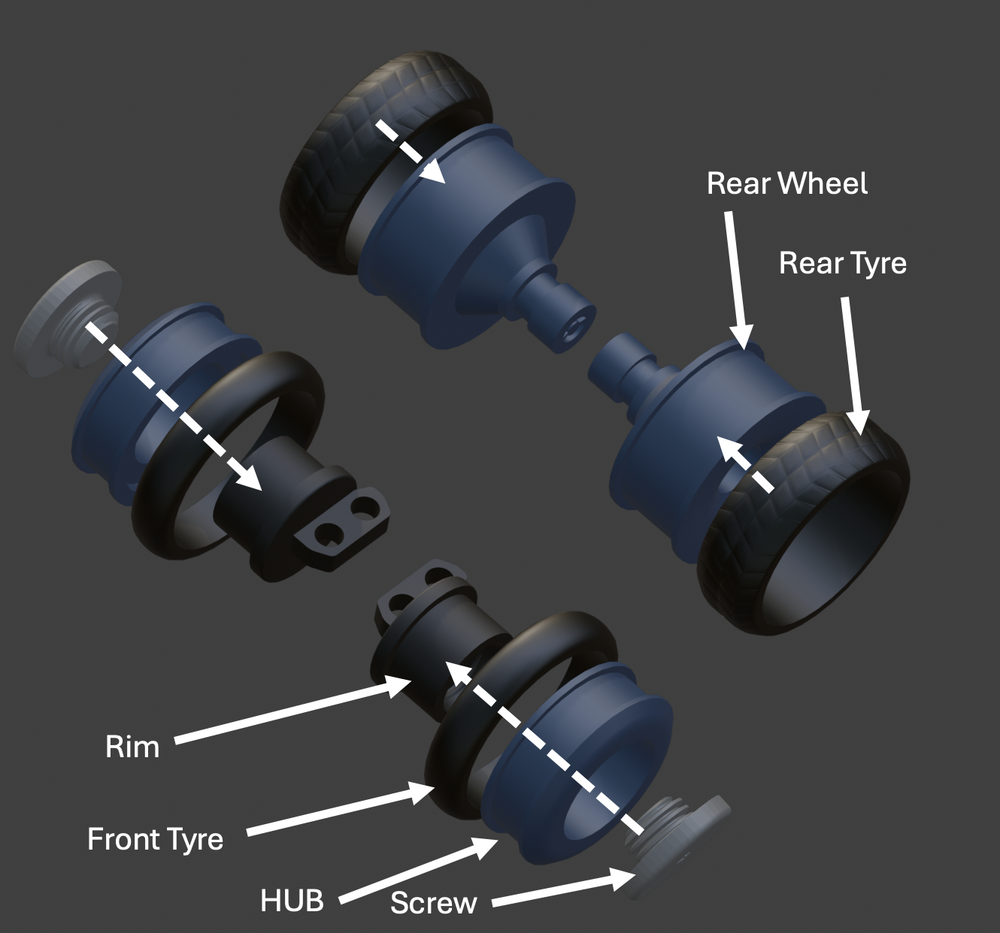

**Please note:** Front Screws and Rims are not symmetrical, notice there are left and right 3D models

### 2.2 Assemble Chassis

  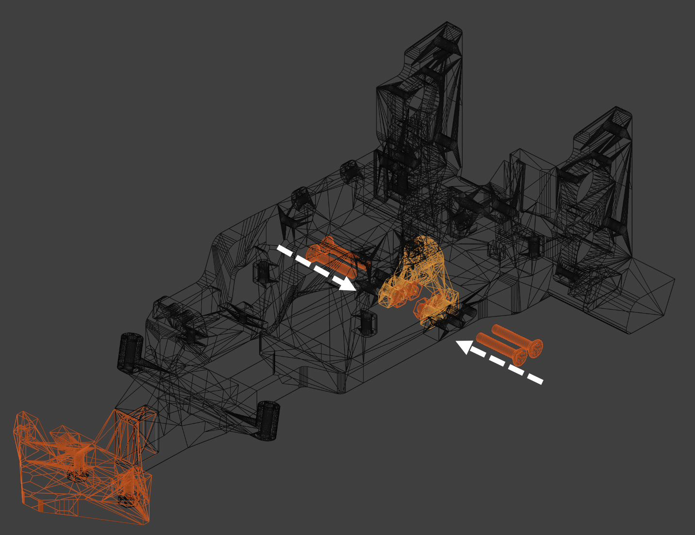

**Components in previous picture:** Nose Cone, M3 Screws, Axle Holder.

### 2.3 Assemble Rear Drive System

  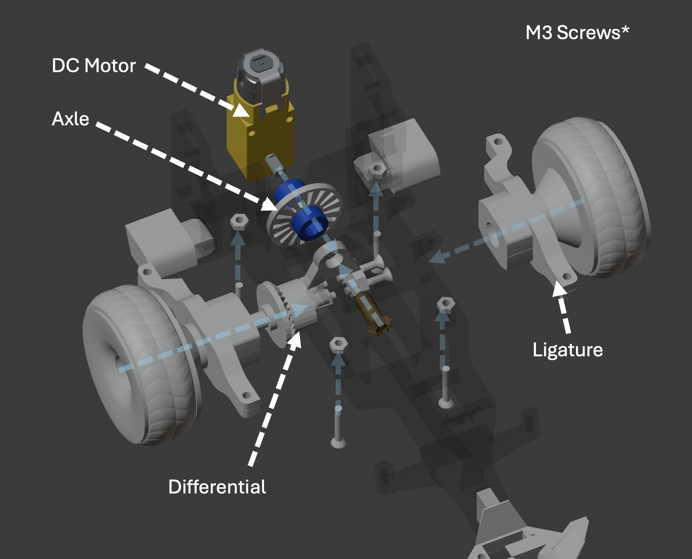

  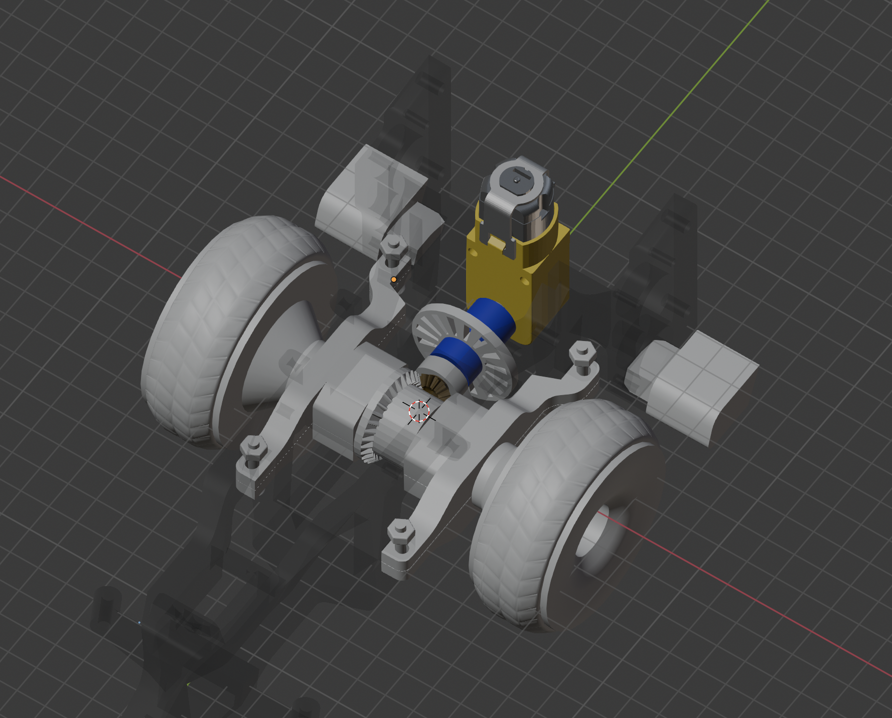

### 2.4 Assemble Encoder

  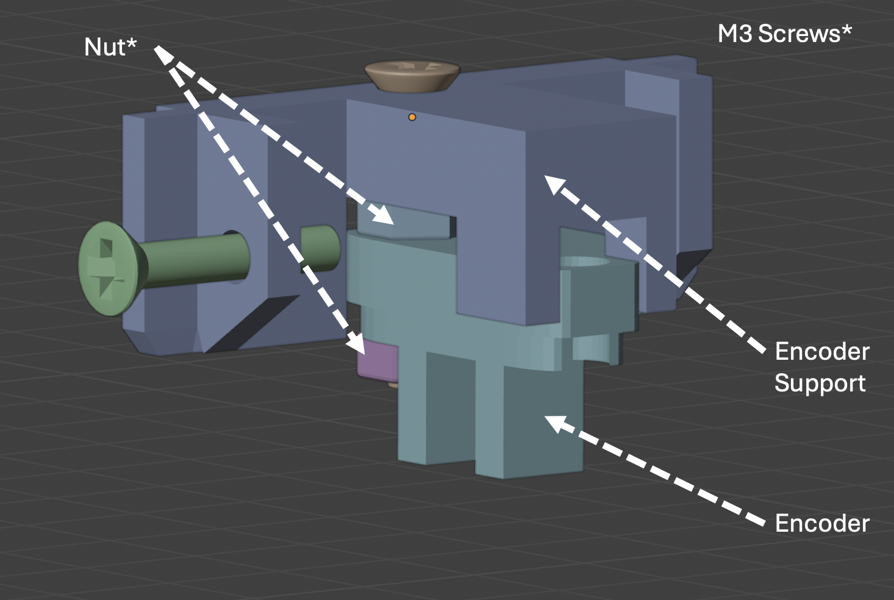

### 2.4 Secure Motor and Install Encoder

  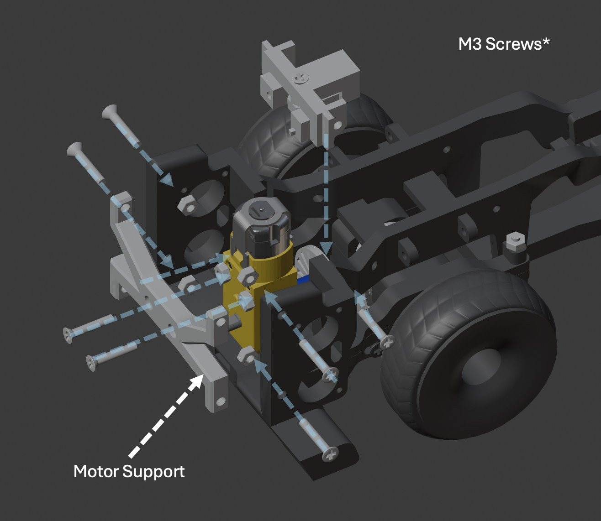

  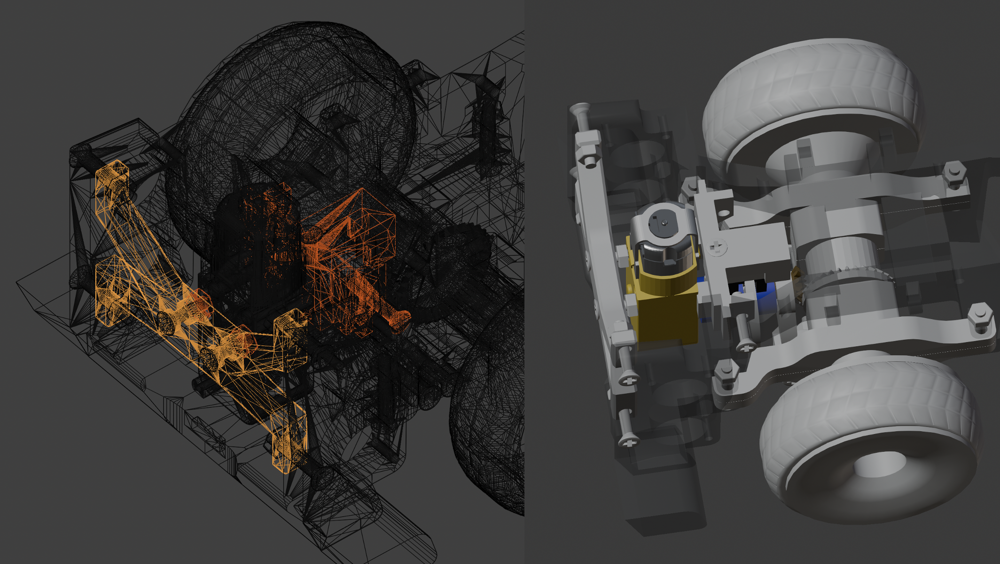

### 2.6 Build Front Axle

  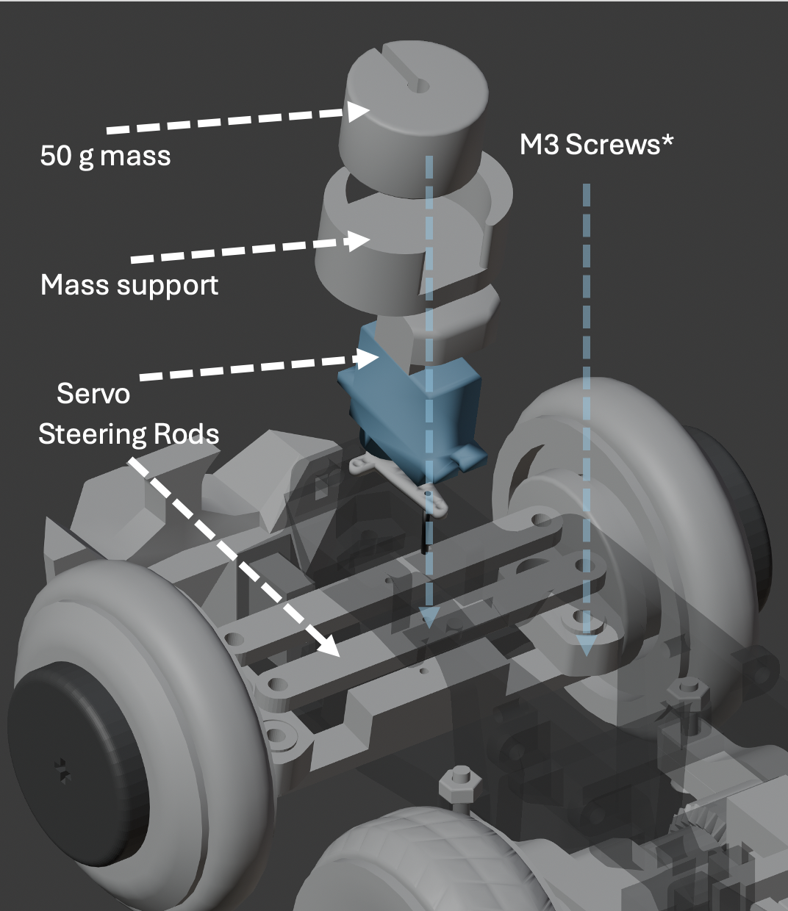

### 2.7 Place Rear Electronics

**Parts:** 2x rear ultrasonic, PCB, Mega2560, Mega2560 Plaftorm.

  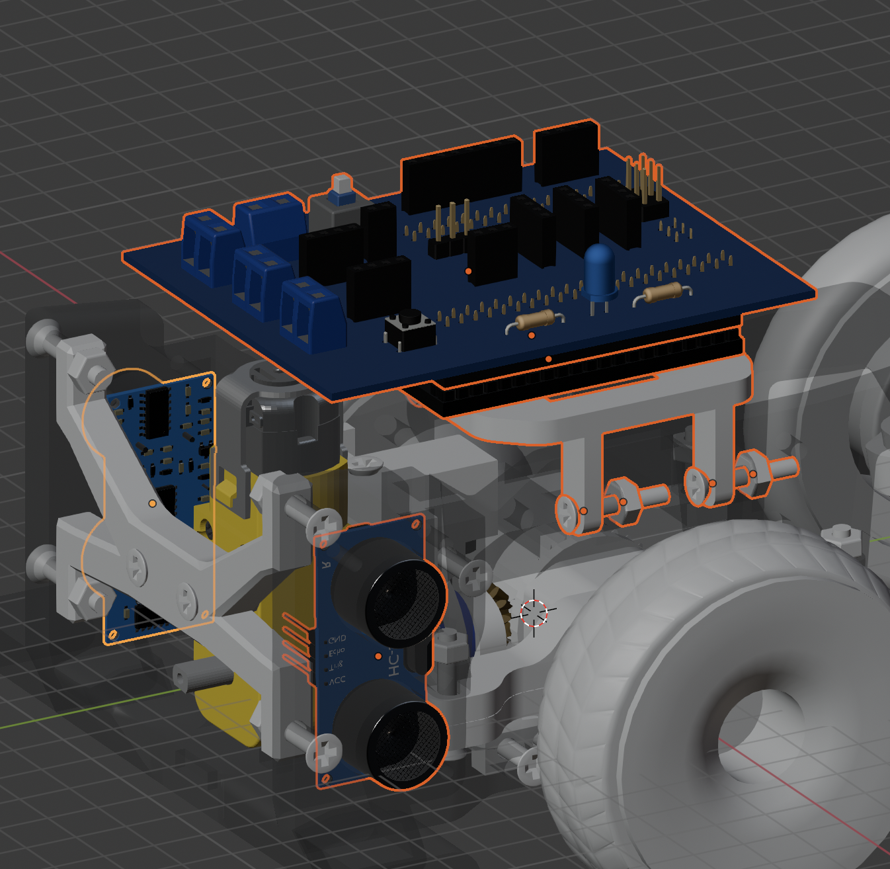

### 2.7 Place Rear Electronics

**Parts:** Front ultrasonic, floor color sensor, OpenMV.

  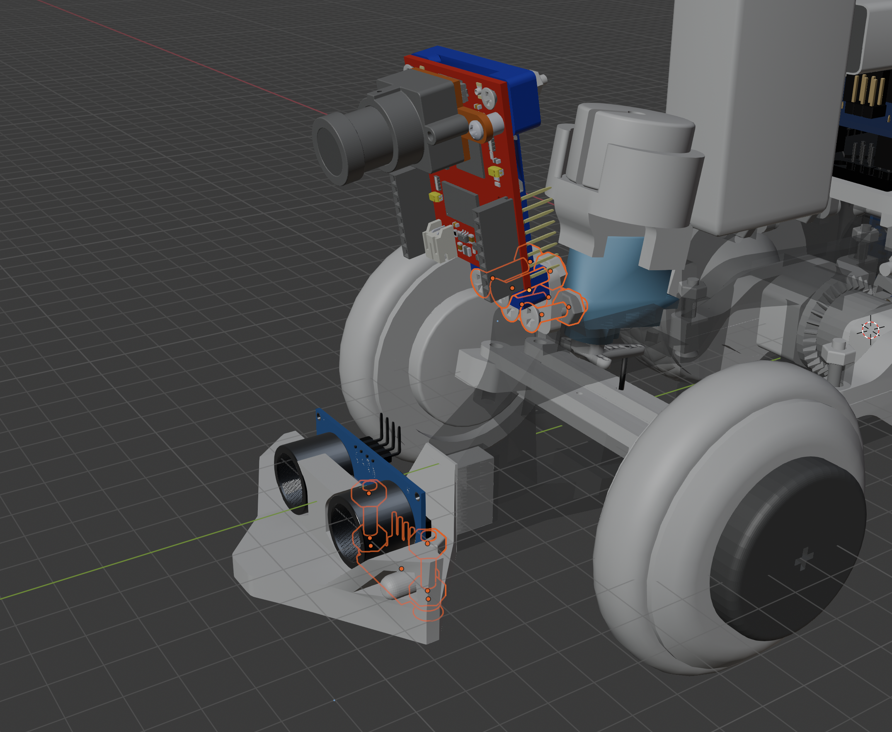

### 2.7 Place Batteries

**Parts:** 9V batteries, 2x 4.2V/3.7V batteries.

  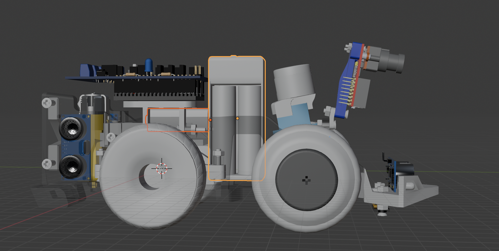

## Step 3 - PCB

We provide two options for this process: manually soldering the PCB, or fabricating it with a PCB supplier. Find the [circuit diagram or PCB files](#112-components-and-wiring).

## Step 4 - Software

**Required Apps:**

* **[Arduino IDE](https://www.arduino.cc/en/software)**  
  Required for writing, compiling, and uploading C++ firmware to microcontrollers.
* **[OpenMV IDE](https://openmv.io/pages/download)**  
  Required for scripting, camera sensor configuration, and vision processing on OpenMV microcontrollers.

Install these libraries via the **Arduino Library Manager** (`Sketch` ➔ `Include Library` ➔ `Manage Libraries...`) or download them directly using the links below:

| Header File | Library Name | Description / Function | Source Link |
| :--- | :--- | :--- | :--- |
| `<Wire.h>` | **Wire** *(Built-in)* | I2C communication interface for onboard sensors and peripherals. | *Built-in with Arduino Core* |
| `<Adafruit_MPU6050.h>` | **Adafruit MPU6050** | Driver for the MPU-6050 6-axis accelerometer and gyroscope module. | [GitHub Repository](https://github.com/adafruit/Adafruit_MPU6050) |
| `<Adafruit_Sensor.h>` | **Adafruit Unified Sensor** | Base unified sensor hardware abstraction layer required by Adafruit drivers. | [GitHub Repository](https://github.com/adafruit/Adafruit_Sensor) |
| `<Adafruit_TCS34725.h>` | **Adafruit TCS34725** | Driver for the TCS34725 RGB color sensor. | [GitHub Repository](https://github.com/adafruit/Adafruit_TCS34725) |
| `<Servo.h>` | **Servo** *(Built-in)* | Standard servo motor control library for pulse-width modulation (PWM). | *Built-in with Arduino Core* |
| `<NewPing.h>` | **NewPing** | Optimized library for ultrasonic distance sensors (HC-SR04, SRF05, etc.). | [GitHub Repository](https://github.com/teckel12/arduino-new-ping) |

**Code:**

[Download the code here](./../src/)

**Arduino Upload**: 
  * **Source**: Upload the code directly from the Arduino IDE.
  * **Target:** Upload to the Mega 2560 internal storage. *(board name inside IDE: Arduino Mega 2560)*.

**OpenMV Upload**:
  * **Source**: Upload the code directly from the OpenMV IDE. 
  * **Target:** Upload either to an external micro SSD and plug it inside the camera or upload into built-in memory.
