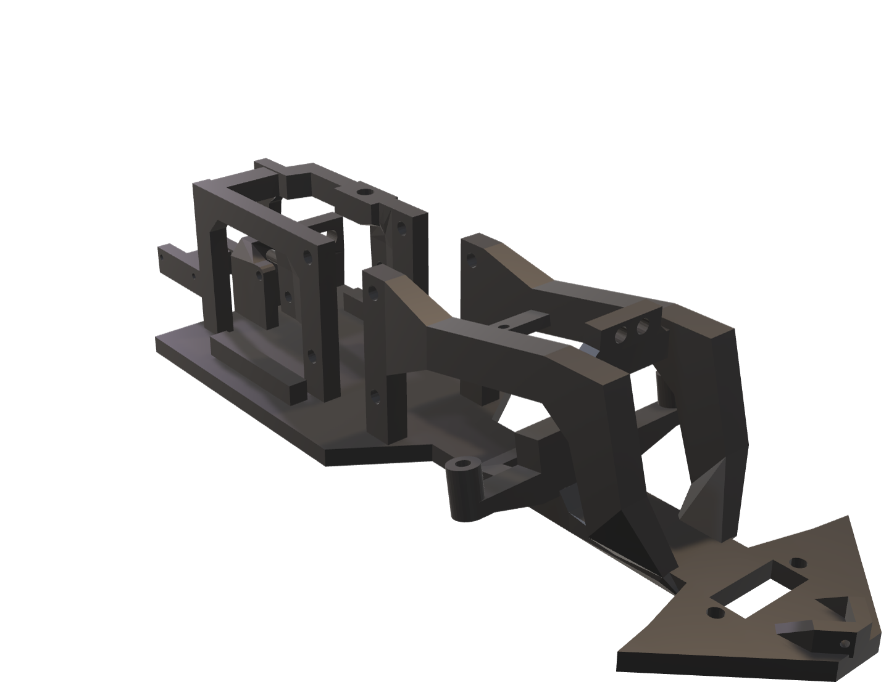
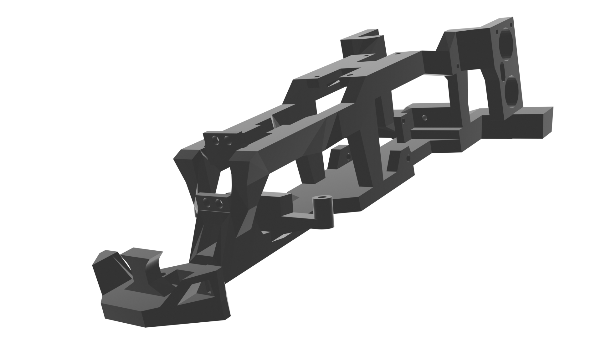
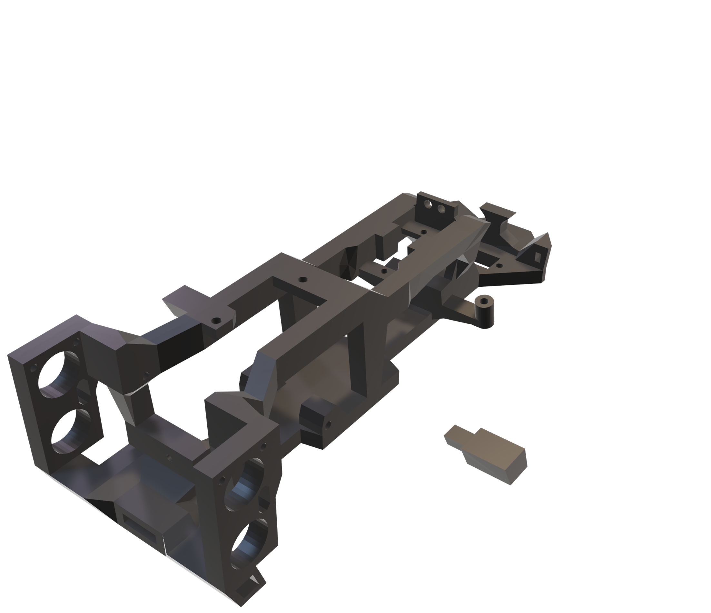
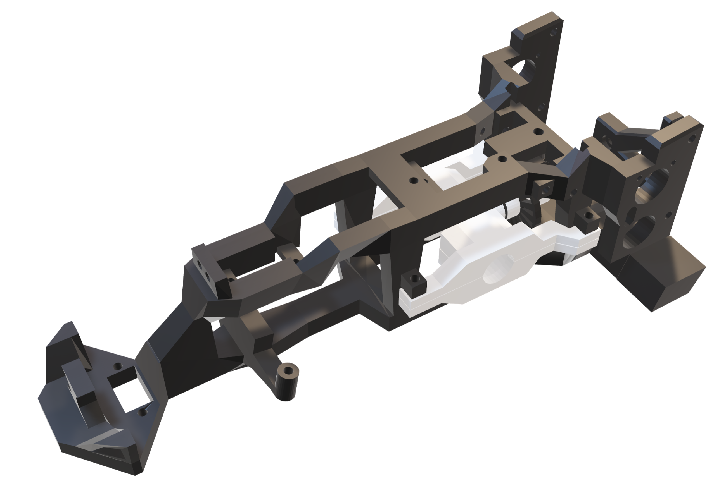
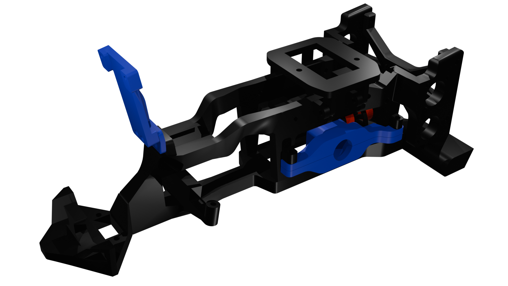
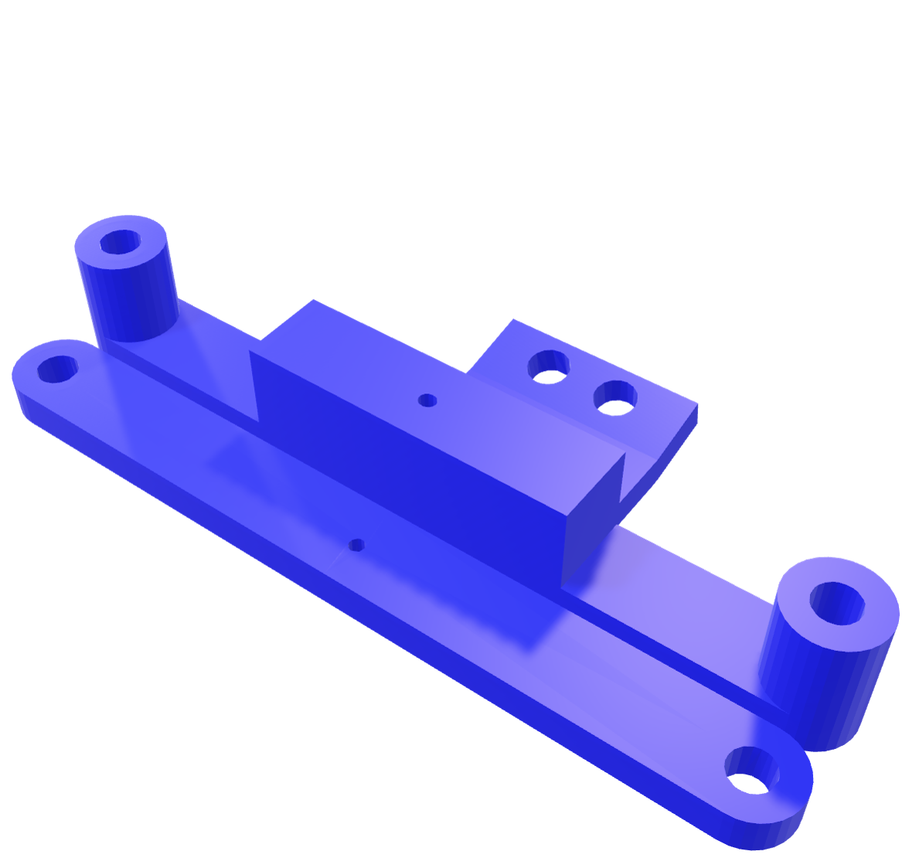
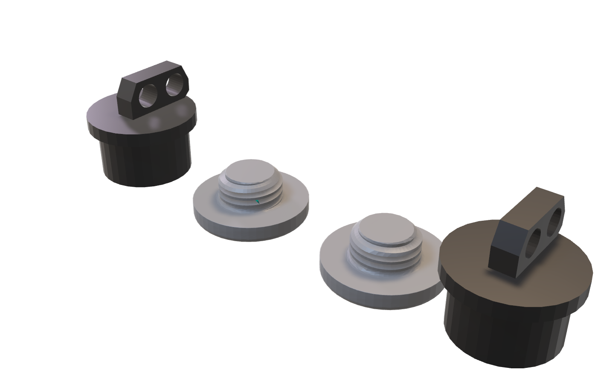
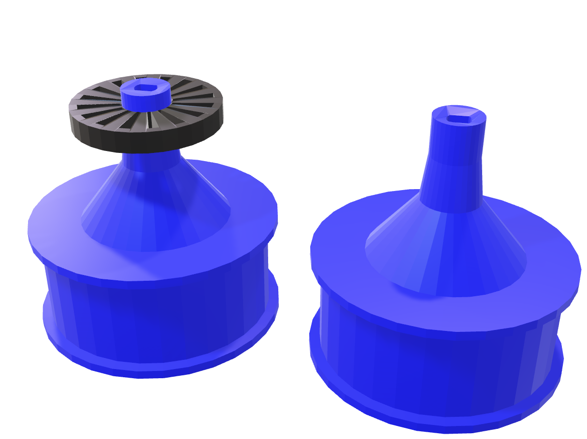
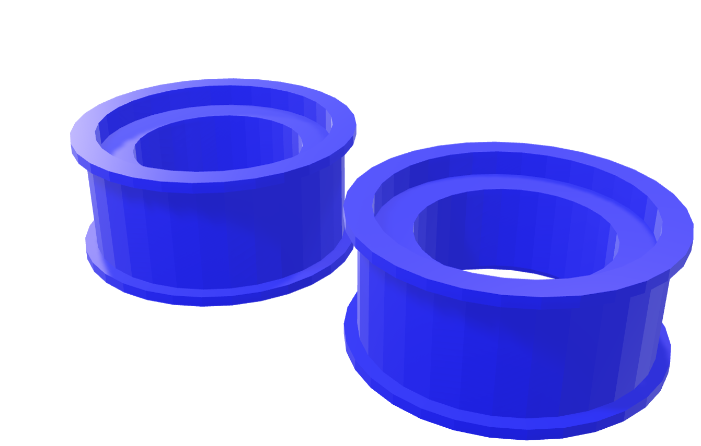

# Models Folder

Here you can find all the .stl and .glb models of every 3D modeled part of our robot.

The .glb models are used for the HTML embeds hosted in GitHub pages. 
We designed these embeds for a more interactive visualization of the models and their colors in the real-life robot. However, the .stl files can also be visualized directly in GitHub.

The designs included in this file directory are:

## 1. Chassis Model

| ViZio | ViZio 2.0 | ViZio V3 | ViZio IV | ViZio Phase 5 |
| :----------------: |  :----------------: |  :----------------: |  :----------------: | :----------------: |
| [Chassis](./chassis/chassis.stl) | [Chassis](./chassis/chassis2.0.stl) | [Chassis](./chassis/ViZioInternationalMotorFix.stl) | [Chassis](./../docs/10_3d_modeling.md#chassis) | [Chassis](./../docs/10_3d_modeling.md#chassis) |
|  |  |  |||
| [Chassis Embed](https://vd-wro.github.io/VD26/embeds/interactive_chassis)| [Chassis Embed](https://vd-wro.github.io/VD26/embeds/interactive_chassis2) | [Chassis Embed](https://vd-wro.github.io/VD26/embeds/chassis_final) | [Chassis Embed](https://vd-wro.github.io/VD26/embeds/chassis_26) | [Chassis Embed](https://vd-wro.github.io/VD26/embeds/chassis_26.2) |

## 2. Steering

### 1. [Steering Rod and Camera Support](./../docs/10_3d_modeling.md#steering-rods-and-camera-support)

## 3. Wheels Models

### 1. [Wheel Hubs](./../docs/10_3d_modeling.md#front-wheel-hubs-with-screws)

### 2. [Rear Wheels](./../docs/10_3d_modeling.md#rear-wheels)

### 3. [Wheel Rims](./../docs/10_3d_modeling.md#front-wheel-rims)

---

For an explanation on the design and 3D printing of these models, refer to the document: [**10. 3D Modeling**](../docs/10_3d_modeling.md)
